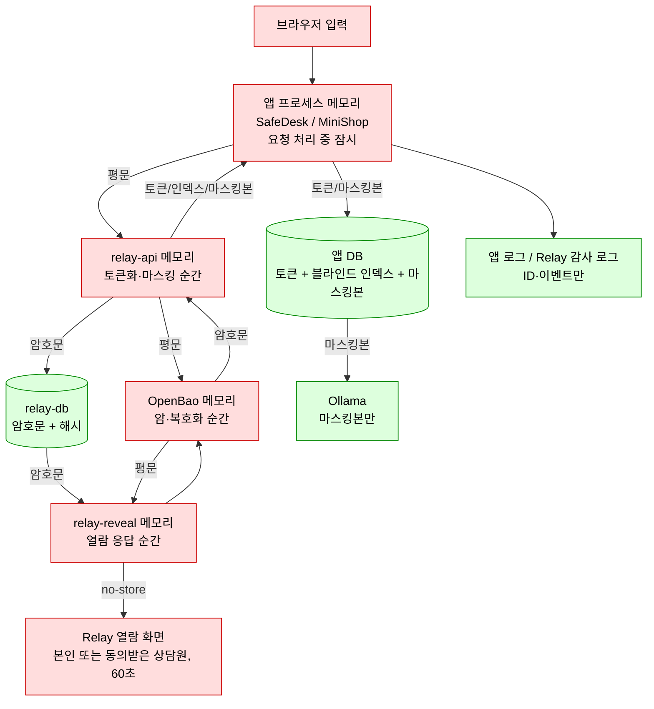
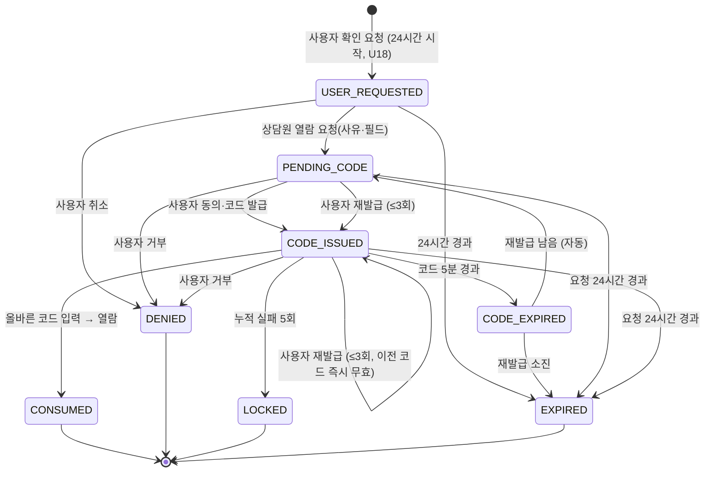
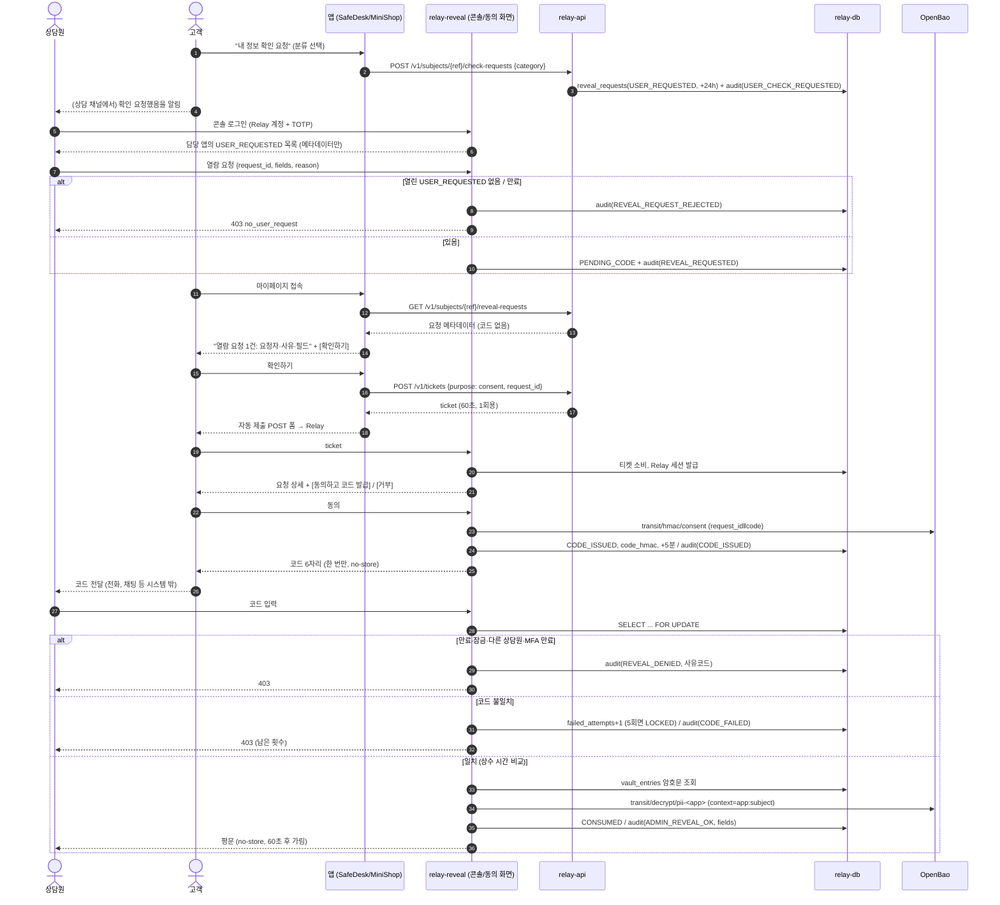

# Secure AX on K3s — 설계 문서 (PII Relay + SafeDesk + MiniShop)

- 작성일: 2026-11-11
- 상태: 초안 v5
  - v5 (2026-11-20): 사용자 결정 U21~U35 반영. **호스팅을 OCI Always Free에서 MacBook의 로컬 Lima VM으로 바꾸고, 공개 접근은 Cloudflare 이름 있는 터널로 한다.** OCI 내용은 지우지 않고 "향후 이전 경로(TARGET=oci, 보류)"로 옮겼다. 바뀐 곳: §3, §4, §5.2, §6, §10(N5 폐지), §11, §13.3, §15, §15.1, §16, §17(S1·S11·S12), §17.1, §18, §19, §20(M1·M3·M4·M6·M7·M9), §21, §22, §24, §25, 부록 A. 근거 ADR-0014, ADR-0015 신규, ADR-0002·0003·0008·0010·0011 상태 갱신
  - v4: 사용자 결정 U18~U20(사용자 먼저 시작하는 관리자 열람, 공개 데모 정책, 마감 없음) 반영. 리뷰 반영(본인 열람 딥링크, S10 주장 범위, 감사 앵커 CronJob, 물리 삭제, 동의 코드 상태 전이, 마일스톤 순서)
  - v2: 개인정보 보호 기능을 독립 컴포넌트 "PII Relay"로 분리, 두 번째 데모 앱 추가
  - v3: OCI Always Free 한도 정정(2 OCPU / 12 GB), 리소스 예산표, 외부 LLM 제거(Ollama 전용), 비용 가드레일, 기술 선정 근거(ADR), 면접 예상 질문 추가
- 표기 규칙
  - **[사용자 결정]**: 사용자가 직접 정한 것. 빌더가 임의로 바꾸지 않는다.
  - **[Claude 제안]**: 어시스턴트가 정한 기본안. 빌더는 근거를 남기면 바꿀 수 있다.
  - **[Claude 결정(리뷰 반영)]**: 리뷰어 점검 후 coordinator가 확정한 사항. 빌더가 임의로 바꾸지 않는다.
  - **[빌더 재량]**: 정답이 없어 구현자가 정한다. 정한 결과는 `docs/adr/`에 ADR 한 장으로 남긴다 (§24 형식).

---

## 목차

1. 의도와 이유
2. 목표 / 비목표 / 안티목표
3. 제약
4. 사용자 결정 사항 요약
5. 시스템 구성
6. 컴포넌트별 책임
7. PII Relay 설계 (API, 앱별 설정, 연동 방식, SDK)
8. 데이터 모델 개요
9. 원본 PII 열람 플로우 (본인 열람 / 동의 코드)
10. 네트워크 정책 매트릭스
11. 인그레스 설계
12. 인증 / 인가
13. 감사 로그 설계
14. LLM 및 마스킹
15. 워크로드 하드닝과 시크릿
16. 위협 모델 (STRIDE 간단판)
17. 공격 시연 시나리오와 기대 결과
18. CI/CD 보안
19. 무료 인프라 구성, 비용 가드레일, 대안
20. 마일스톤
21. 빌더에게 맡기는 것
22. 정직한 한계
23. 제품화 로드맵 (이번 범위 밖)
24. 기술 선정 근거 (ADR 요약)
25. 면접 예상 질문과 답변
- 부록 A. 확인 필요 사항

---

## 1. 의도와 이유

- 지금까지 만든 포트폴리오는 "고객 니즈를 기능으로 해결"하는 것이었다. 이번 프로젝트는 **보안을 제대로 구현했다는 것을 증명**하는 것이 목적이다.
- 핵심 주장 **[사용자 결정]**:
  > 고객도, 서비스 운영자(관리자)도 DB에 저장된 개인정보·이용 데이터에 직접 접근할 수 없다. 원본은 정해진 절차를 거쳐야만 볼 수 있고, 볼 때마다 흔적이 남는다.
- 범위 변경 **[사용자 결정]**: 개인정보 보호 기능을 특정 서비스 안에 섞지 않고 **재사용 가능한 독립 컴포넌트 "PII Relay"**로 만든다. 그리고 **서로 다른 두 앱이 설정만 바꿔 같은 Relay에 연동되는 모습**을 보여주는 것이 핵심 산출물이다.
  - 앱 1: **SafeDesk** (AI 고객문의 접수·분류·답변 초안). Relay의 첫 소비자.
  - 앱 2: **MiniShop** (가벼운 쇼핑몰 회원가입·주문). 설정 파일과 SDK 호출만으로 연동한다.
- 이렇게 하면 주장이 "이 앱 하나는 안전하다"에서 **"어떤 앱이든 이 Relay에 붙이면 앱 코드에 암호화 로직 없이 같은 보장을 얻는다"**로 넓어진다. 증명 포인트는 MiniShop 코드에 암호화 코드가 한 줄도 없다는 것이다.
- 평가받는 부분은 기능이 아니라 **보안 경계, 인그레스, 재사용성, 증거**다. 앱 기능은 단순하게 유지한다.

## 2. 목표 / 비목표 / 안티목표

### 목표
| # | 목표 | 완료 판단 |
|---|---|---|
| G1 | §9의 열람 규칙(본인 열람, 동의 코드 기반 관리자 열람)을 Relay에 구현하고 두 앱 모두에서 동작 | S5 통과, 두 앱 E2E 통과 |
| G2 | 토큰화, 필드 암호화, 권한 분리, 네트워크 격리, 인그레스 보안, 감사 로그를 실제 클러스터에서 운영 | §17 S1~S7 통과 |
| G3 | 두 번째 앱을 **설정 파일과 SDK 호출만으로** 연동 | S8~S10 통과, 연동 diff 공개 |
| G4 | 제3자가 따라 할 수 있는 증거 | `attacks/` 스크립트, README 결과, 3~5분 영상. 공개 데모에서 면접관이 데모 계정(사용자 + 상담원)으로 동의 플로우 양쪽을 직접 시연할 수 있음 (U19, §17.1) |
| G5 | 운영 비용 0원 (프로젝트 추가 비용 기준. 도메인은 기존 개인 도메인, U29) | Cloudflare 구독 0개·Free 플랜, GitHub 사용량 0원 (§19.2 CG10 증거) |

### 비목표
- 멀티테넌시, 과금, SLA, 셀프서비스 온보딩 **[사용자 결정]** → §23 제품화 로드맵에만 적는다.
- 멀티노드 HA, 실제 결제, 실제 이메일·SMS 발송, ISMS-P 등 인증 취득, 대규모 트래픽, 화려한 UI **[Claude 제안]**
- 다국어 SDK. Python SDK 하나만 만든다 **[Claude 제안]**

### 안티목표 (이렇게 되면 실패)
- 문서에만 있고 시연으로 증명되지 않는 보안 통제
- 로그, 에러, 스택 트레이스, LLM 프롬프트, 메트릭 라벨 등 어디에든 원본 PII가 남는 것
- 비용 발생 (평가판 크레딧 소진 뒤 과금 포함)
- **범위가 커져서 혼자 끝내지 못하는 것** **[사용자 결정]**
- **Relay를 범용 제품처럼 과하게 일반화하는 것** **[사용자 결정]**. 예: 플러그인 시스템, 범용 정책 DSL, 테넌트 관리, 다국어 SDK, 임의 필드 타입 확장 프레임워크. 규칙: **Relay 기능은 두 앱 중 하나가 실제로 쓰는 것만 만든다.**

## 3. 제약

| 항목 | 내용 |
|---|---|
| 비용 | 프로젝트 추가 비용 0원 (무료 티어, 오픈소스만). 도메인 `whoareryu.cloud`는 기존 개인 도메인이라 프로젝트 비용에 넣지 않는다 (U29) |
| 노드 | 단일 노드 K3s |
| 호스팅 **[사용자 결정]** U21, U23 | `TARGET=local`: MacBook 위 **Lima VM** 한 대(Ubuntu 24.04 arm64, `vmType: vz`). 포트폴리오를 보여줄 때만 켠다. `TARGET=oci`는 구조만 두고 구현하지 않는다 (향후 이전 경로, §19.1.1) |
| 아키텍처 | ARM64 (Apple Silicon 위 Lima VM. 향후 이전 대상인 OCI Ampere A1도 arm64). 모든 이미지를 `linux/arm64`로 빌드 |
| 자원 **[사용자 결정]** U22 | Lima VM **2 CPU / 12 GiB RAM / 디스크 100 GiB**. OCI Always Free A1 한도(2 OCPU / 12 GB, 2026-06 축소)와 같게 맞춰 §15.1 예산표를 그대로 쓴다 |
| 가용성 **[사용자 결정]** U21, U26 | Mac이 켜져 있고 VM이 실행 중일 때만 공개 링크가 동작한다 |
| 네트워크 **[사용자 결정]** U24 | **인바운드 공개 포트 0개.** 공개 경로는 Cloudflare 에지 → cloudflared(VM 호스트, 아웃바운드 연결) → Traefik 하나뿐이다. 관리 경로는 Lima 포워드 Mac `127.0.0.1:6443`과 `limactl shell`뿐 |
| 스토리지·네트워크 (OCI, 보류) | 부트+블록 볼륨 합계 200 GB, Object Storage 20 GB(Always Free 계정), 아웃바운드 월 10 TB. `TARGET=oci`로 이전할 때만 적용 |
| LLM | 클러스터 내 Ollama 전용. 외부 LLM API는 쓰지 않는다 **[사용자 결정]** |
| 인력 | 1인 개발 |
| 백엔드 | Python + FastAPI **[사용자 결정]** (Relay, SafeDesk, MiniShop 모두) |
| 테넌시 | 단일 테넌트. 앱별 설정과 앱별 OpenBao Transit 키 분리까지만 **[사용자 결정]** |

## 4. 사용자 결정 사항 요약

| ID | 결정 |
|---|---|
| U1 | 간단한 AX 서비스 + 보안과 인그레스 관리를 K3s에서 운영 |
| U2 | 비용 0원 |
| U3 | 백엔드는 Python + FastAPI |
| U4 | DB의 개인정보는 암호화 저장, 프로젝트 주인(관리자)도 마음대로 볼 수 없음 |
| U5 | 사용자 본인은 로그인 후 마이페이지에서 본인 원본 열람 가능, 열람 로그 남김 |
| U6 | 관리자는 사용자가 확인을 요청한 경우에만: 관리자가 사유와 함께 열람 요청 → 로그 → 그 시점에만 사용자 마이페이지에 일회용 코드 표시 → 사용자가 관리자에게 코드 전달 → 관리자가 입력하면 그때에만 열람 |
| U7 | 개인정보 보호 기능(토큰화/암호화, 블라인드 인덱스, OpenBao 연동, 복호화, 동의 코드 플로우, 감사 로그, 마스킹)을 독립 서비스 **PII Relay**로 분리. SafeDesk는 첫 소비자 |
| U8 | 두 번째 가벼운 데모 앱을 같은 Relay에 설정만 바꿔 연동하는 것이 핵심 산출물 |
| U9 | 연동 방식은 빌더 재량으로 두되 기본값을 명시 (기본값 자체는 §7.3의 Claude 제안) |
| U10 | 단일 테넌트 유지. 멀티테넌시·과금·SLA·셀프서비스 온보딩은 비목표, 제품화 로드맵에만 기록 |
| U11 | 공격 시연에 "데모 앱 DB 덤프 → 토큰·암호문만"과 "데모 앱 자격증명으로 SafeDesk 키 접근 불가"를 추가 |
| U12 | LLM은 Ollama 전용. Gemini 무료 티어는 사용하지 않는다 (무료 티어 입력이 Google 제품 개선에 쓰일 수 있어 프로젝트 메시지와 충돌) |
| U13 | 비용 가드레일(§19.2)을 지킨다: PAYG 업그레이드 금지, Always Free shape만, 예산 알림 1달러, OCI LB 미사용, 볼륨 200 GB 이하, 공개 저장소 + GHCR |
| U14 | 기술 선택마다 면접에서 그대로 말할 수 있는 근거를 ADR 형식으로 남긴다 (§24, `docs/adr/`) |
| U15 | 동의 코드는 앱 마이페이지 알림에서 이어지는 **Relay 자체 동의 화면**에 표시한다 (코드와 원본이 앱을 거치지 않게). §9.3의 해석을 사용자가 확인함 |
| U16 | 원본 열람은 **Relay 전용 상담원 계정(TOTP)**으로만 한다. 이중 로그인 불편은 감수하되 최소화한다. 사용자 확인함 |
| U17 | 원칙: 보안 강화로 늘어나는 지연·불편은 감수하되 **최소화**하는 것이 설계 목표다. 불편을 줄이는 장치(예: Relay 세션 유지 시간, 알림 딥링크, 비동기 처리로 체감 지연 줄이기)를 빌더가 고려하고, 보안을 약화시키는 방식으로는 줄이지 않는다 |
| U18 | 관리자 열람은 **반드시 사용자가 먼저 시작**한다. 사용자가 앱에서 "내 정보 확인 요청"을 보냄 → 상담원이 사유를 붙여 열람 요청 → Relay 동의 화면에 코드 표시 → 사용자가 상담원에게 코드 전달 → 열람. 사용자 요청이 없으면 상담원은 열람 요청을 만들 수 없고 API에서 거부된다. 앱은 PII를 만지지 않으므로 확인 요청도 Relay API로 위임한다 |
| U19 | 공개 데모는 **회원가입을 끄고**, 면접관용 데모 계정(사용자 + 상담원)과 **합성 데이터만** 둔다. 면접관이 혼자 동의 플로우 양쪽을 시연할 수 있어야 한다 |
| U20 | **마감일 없음**. 마일스톤(합계 약 9~11주)은 그대로 두고 사용자가 자기 속도로 압축해 진행한다. "자르는 순서"는 참고용 |
| U21 (2026-11-20) | **당분간 OCI를 쓰지 않는다.** 런타임은 MacBook의 Lima VM(Ubuntu 24.04 arm64) 한 대이고, 포트폴리오를 보여줄 때만 켠다. 근거(조사, Claude): OCI A1의 리전·용량 제약(춘천 리전 A1 제외, 서울 단일 AD, 용량 부족 보고는 일화 수준, 한도 축소, 유휴 회수) (§19.1.1, ADR-0014) |
| U22 (2026-11-20) | VM 자원은 **2 CPU / 12 GiB / 디스크 100 GiB** (OCI A1 한도와 같게, §15.1 예산 유지) |
| U23 (2026-11-20) | 확장성은 **구조만** 둔다: `TARGET=local\|oci`, `k8s/overlays/oci`는 자리만, OCI 런북은 "future(미검증)". `TARGET=oci`는 "not implemented"로 거부한다. 검증되지 않은 OCI 전용 코드는 만들지 않는다 |
| U24 (2026-11-20) | 공개 접근은 **Cloudflare 이름 있는 터널**. cloudflared는 **VM 호스트의 systemd 서비스**(클러스터 밖). 호스트는 `safedesk.whoareryu.cloud`, `minishop.whoareryu.cloud`, `relay.whoareryu.cloud`. zone은 이미 Cloudflare 네임서버에 있고, apex와 `www`(Vercel, DNS-only)는 **건드리지 않는다**. 터널은 CLI로 만들고 ingress 설정은 저장소의 `config.yml` 템플릿으로 관리한다. 계정 인증서 `cert.pem`은 터널 생성·DNS 라우팅 직후 삭제하고, 터널 자격 증명 JSON은 백업하지 않는다(분실 시 재생성) (ADR-0015) |
| U25 (2026-11-20) | 원본 TLS는 **cert-manager + Let's Encrypt DNS-01**(Cloudflare). API 토큰은 이 zone 하나, DNS 편집 권한, 집 공인 **IPv4** 필터, 6개월 만료. (+ Zone·Zone·Read: cert-manager Cloudflare solver의 zone ID 조회에 기술적으로 필요 → 사용자 승인 2026-11-20. 원래 사용자 결정은 "zone DNS 편집만") 토큰 원본은 Mac 키체인에 두고 K8s Secret은 거기서 만든다 (ADR-0003 갱신) |
| U26 (2026-11-20) | 공개 링크는 **Mac이 켜져 있는 동안 누구나** 접근할 수 있다 (Cloudflare Access 로그인 없음). 대신 (a) 위험한 외부 접근 (b) 비용이 생길 수 있는 경로 (c) 개인정보를 수집·유출할 수 있는 경로를 강하게 막는다 |
| U27 (2026-11-20) | 공개 모드 데이터 통제: **합성 데이터만 + 가입 비활성**(U19 유지). 자유 입력란은 허용하되 "실제 개인정보 입력 금지" 경고, 길이 제한, **짧은 보존**(약 1시간마다 앱 데이터와 Relay 주체를 물리 삭제, 감사 로그는 유지). Traefik 접근 로그에 방문자 IP를 남기되 7일 이하 보존. M1에는 더미 앱만 공개하고, 실제 앱은 공개 모드 통제가 검증된 뒤에만 공개 호스트에 붙인다 (M3/M6 완료 기준). M1에 `body-limit`(64 KiB) 미들웨어를 넣는다 |
| U28 (2026-11-20) | Cloudflare 에지: 목표에 맞는 **무료 통제는 모두 켠다** — Bot Fight Mode, Free Managed Ruleset, rate limiting 규칙 1개(민감 경로, IP당 10초에 5회 초과 → 10초 차단), WAF 커스텀 규칙 R1 KR 외 국가 차단, R2 relay `/console` Managed Challenge, R3 `/signup` 차단, R4 메서드 GET/POST/HEAD만, R5 예비, 세 호스트 캐시 우회. 엄격한 CSP는 유지하고 Bot Fight Mode JS 탐지 영향은 기록한다(nonce는 M3에서 재검토). 설정은 대시보드에서 하고 읽기 전용 API 토큰으로 JSON을 내보내 증거로 남긴다. 국가 차단 증거는 대시보드 + GitHub Actions 미국 러너 관측(봇 챌린지는 따로 표시) (§11.4) |
| U29 (2026-11-20) | Cloudflare 비용 통제: 결제수단 확인·제거 안내, **금지 유료 기능 목록**, 월간 청구 화면 점검(CG10 확장) (§19.2 CG-CF1~CG-CF4). README에는 "기존 개인 도메인 사용, 프로젝트 추가 비용 0원"이라고 쓴다 |
| U30 (2026-11-20) | 로컬 관리 접속: **Tailscale을 쓰지 않는다.** kube API는 Lima 포워드 Mac `127.0.0.1:6443`, 셸은 `limactl shell`. 로컬에서는 **호스트 방화벽을 생략**하고 OCI로 옮길 때 도입한다 (ADR-0010 보류) |
| U31 (2026-11-20) | M1 더미 앱은 고정 문구 정적 응답 이미지(arm64, non-root, digest 고정). `audit-anchor`의 외부 기록 대상은 **M4에서 결정**한다 (후보: 별도 공개 GitHub 저장소에 append-only 커밋. OCI Object Storage는 `TARGET=oci` 때의 후보) |
| U32 (2026-11-20) | 진행 규칙: 환경 변수 인터페이스 변경은 M1 Task 2 Step 0에서 한다. 스크립트는 bash 3.2 호환. 커밋에 `Co-Authored-By` 트레일러를 넣지 않는다. 모든 결정은 사용자가 내리며, 질문에는 추천안을 함께 붙인다. 독립 작업은 서브에이전트를 병렬로 돌린다 |
| U33 (2026-11-20) | 공개 데모 운영 세부: (1) 요청자별 데모 계정은 **7일 유지**하고, 약 1시간 초기화는 그 계정의 **데이터만** 물리 삭제(문의, 주문, 메모, 열람 요청, 사용으로 생긴 Relay 주체)한 뒤 합성 프로필을 다시 시드한다. 계정 자체는 7일에 만료 (2) Mac이 꺼져 있으면 방문자는 Cloudflare 기본 오류 화면을 본다. 사용자 지정 오류 페이지는 두지 않고, README에 "시연은 요청 시 Mac을 켜서 공개합니다. 평소에는 Cloudflare 기본 오류 페이지가 나오며, 영상·캡처를 참고해 주세요."라고 쓴다 (3) `console-ipallow`는 **쓰지 않는다**. relay `/console`은 에지 Managed Challenge + rate limit 규칙 + 상담원 TOTP로 보호한다 (U19: 면접관이 상담원 쪽도 시연) (4) S1은 리스너·포워드·터널 감사·공개 호스트 음성 검사에 더해, **같은 LAN의 다른 노트북 또는 Termux에서 nmap을 돌리는 휴대폰에서 Mac LAN IP를 nmap**으로 스캔해 VM 포트가 Mac 밖으로 새지 않음을 보인다 (같은 Mac의 Docker 컨테이너는 한계를 증거에 적는 대체 수단, U34·U35) (5) 자유 입력 길이: 문의 본문 500자, 배송 메모 100자 (6) 시연 시작 스크립트(`make demo-up`)가 `caffeinate`로 잠자기를 막고 시계 차이를 확인하며(TOTP·토큰 만료가 시각에 의존), `make demo-down`은 `caffeinate`를 해제하고 VM을 정지한다(`limactl stop`) |
| U34 (2026-11-20) | U33 세부: (1) LAN nmap 증거는 **같은 LAN의 다른 실제 기기**(다른 노트북 또는 Termux에서 nmap을 돌리는 휴대폰. U35에서 확정)에서 찍은 것을 기본으로 한다. 같은 Mac의 Docker 컨테이너는 대체 수단일 뿐이고, 쓰면 "실제 LAN이 아니라 Docker VM 네트워크를 거쳤을 수 있다"는 한계를 증거에 적는다 (2) 길이 초과는 브라우저 `maxlength` + 서버에서 거부(400과 사용자용 안내 문구). **조용히 자르지 않는다** (3) `make demo-up`/`demo-down`(VM 시작, `caffeinate`, 시계 차이 확인 / `caffeinate` 해제와 VM 정지)은 **M1 Task 12**에서 만든다. M9는 시드·데모 계정 단계만 더한다 |
| U35 (2026-11-20) | (1) `make demo-down`은 `caffeinate`를 해제하고 **VM을 정지**한다(`limactl stop`) (2) LAN 스캔의 대조 포트 18090: **macOS 애플리케이션 방화벽이 켜져 있을 때만** 필요하다. 방화벽이 막으면 **스캔하는 동안만** python을 허용하고 끝나면 제거하며, 포트와 허용 사실을 증거에 적는다. 검증 스크립트는 sudo 없이 `socketfilterfw --getglobalstate`/`--listapps`로 상태만 읽고, `--add`/`--remove`는 사용자가 sudo로 하는 수동 단계다 (3) Cloudflare API 호출은 IPv4로 강제(`curl -4`), VM에 전역 IPv6 이그레스가 없고 cert-manager 이그레스가 IPv4인지 확인, 토큰 IP 필터는 집 공인 IPv4 (4) 설정 내보내기용 읽기 전용 토큰도 DNS-01 토큰과 같은 제한(단일 zone, 집 IPv4 필터, 6개월 만료, Mac 키체인) (5) ID·UUID·이메일을 뺀 정규화 내보내기 JSON을 공개 저장소에 커밋해 드리프트 기준선으로 쓰고 pre-commit 검사로 지킨다 (6) Traefik 접근 로그(방문자 IP 포함)는 VM hostPath 파일에 쓰고 호스트 logrotate `daily` + `maxage 7` (7) DNS-01 토큰의 Zone·Zone·Read는 cert-manager에 기술적으로 필요해 추가했고 사용자가 승인했다 (원래 결정은 zone DNS 편집만) (8) 공개 저장소 증거 가림 규칙: 모든 Cloudflare 대시보드 캡처에서 계정 이메일·계정 이름·ID를 가리고, 검증 출력에서는 Mac 호스트 이름·사용자 이름·홈 경로·MAC 주소·LAN IP를 자리표시자로 바꾼다 (§19.2 CG10) (9) LAN 스캔 기본 증거는 다른 노트북 또는 Termux에서 nmap을 돌리는 휴대폰에서 찍는다. 검증 스크립트가 `nmap -oG` 출력을 읽으므로 nmap이 아닌 스캔 앱은 받지 않는다. 같은 Mac의 Docker 컨테이너는 한계를 증거에 적는 대체 수단이다 |

- U13의 OCI 항목(PAYG 금지, 예산 알림, OCI LB 미사용, 볼륨 200 GB)은 U21에 따라 `TARGET=oci`로 이전할 때까지 **보류**한다. 지우지 않는다 (§19.2).

## 5. 시스템 구성

### 5.1 서비스 개요
| 서비스 | 내용 | 표기 |
|---|---|---|
| **PII Relay** | 앱이 PII를 넘기면 토큰을 돌려준다. 원본은 Relay 안에서 앱별 키로 암호화해 보관한다. 마스킹, 블라인드 인덱스, 본인 열람, 동의 코드 열람, 감사 로그를 맡는다 | [사용자 결정] 분리 / 세부 [Claude 제안] |
| **SafeDesk** | 고객이 가입하고(공개 데모에서는 가입을 끄고 데모 계정 사용, U19) 문의를 쓰면 Relay로 PII를 토큰화하고 본문을 마스킹한다. 마스킹본만 LLM에 보내 분류와 답변 초안을 만들고, 상담원은 마스킹 화면에서 처리한다 | [Claude 제안] |
| **MiniShop** | 회원가입(이름, 이메일, 전화, 주소. 공개 데모에서는 꺼 둠, U19), 로그인, 상품 3개짜리 주문, 배송 메모. 관리자 주문 목록은 마스킹 표시. LLM 없음 | [Claude 제안] |

### 5.2 구성도

```mermaid
flowchart LR
  subgraph Internet
    B[고객/상담원/면접관 브라우저]
    CF[Cloudflare 에지<br/>TLS 종료, WAF, 봇, rate limit]
  end

  subgraph Mac["운영자 MacBook"]
    O[kubectl<br/>127.0.0.1:6443]
  end

  subgraph Node["Lima VM (Ubuntu 24.04 arm64, 2 CPU / 12 GiB, 단일 노드 K3s)"]
    CFD[cloudflared<br/>VM 호스트 systemd<br/>아웃바운드 7844만]
    subgraph ks["ns: kube-system"]
      T[Traefik :80/:443]
      DNS[CoreDNS]
    end
    subgraph sd["ns: safedesk"]
      SDA[safedesk-app :8000]
      SDW[safedesk-worker]
      SDDB[(safedesk-db)]
      OL[Ollama :11434]
    end
    subgraph sh["ns: minishop"]
      SHA[minishop-app :8000]
      SHDB[(minishop-db)]
    end
    subgraph rl["ns: pii-relay"]
      RA[relay-api :8000<br/>내부 전용]
      RR[relay-reveal<br/>:8001 공개 UI / :8002 내부 API]
      RDB[(relay-db)]
    end
    subgraph bao["ns: openbao"]
      OB[OpenBao :8200]
    end
    K8S[kube-apiserver :6443]
  end

  B -- HTTPS --> CF
  CF -- 터널 (VM이 먼저 연결) --> CFD
  CFD -- HTTPS, 원본 인증서 검증 --> T
  O -. Lima 포트 포워드, Mac 127.0.0.1 전용 .-> K8S
  T --> SDA
  T --> SHA
  T -- /self /consent /console --> RR
  SDA --> SDDB
  SDA -- tokenize/mask/index/ticket --> RA
  SDW --> SDDB
  SDW --> OL
  SHA --> SHDB
  SHA -- tokenize/mask/index/ticket --> RA
  SHA -. 선택: detokenize(shipping) .-> RR
  RA --> RDB
  RR --> RDB
  RA -- encrypt/hmac --> OB
  RR -- decrypt --> OB
  RA -- TokenReview --> K8S
  RR -- TokenReview --> K8S
  OB -- TokenReview --> K8S
  subgraph aa["ns: audit-anchor"]
    AN[audit-anchor CronJob<br/>1시간, 유일한 외부 egress]
  end
  AN -- audit_head --> RDB
  AN -- 해시 요약 --> OB
  AN -- 쓰기 전용 자격 증명, 443 --> OS[(외부 앵커 대상<br/>M4에서 결정, U31)]
```

- **[사용자 결정]** U21, U24, U30: 외부에서 VM으로 들어오는 연결은 없다. cloudflared가 VM에서 Cloudflare로 먼저 연결을 열고, 방문자 요청은 그 연결을 타고 들어온다. cloudflared는 클러스터 밖(VM 호스트) 프로세스라 "클러스터 안의 상시 외부 egress는 `audit-anchor`뿐"(§10) 원칙이 그대로 유지된다.
- 향후 `TARGET=oci`로 옮기면 기존 구성(공인 IP → Traefik 80/443, 관리 경로는 Tailscale)이나 같은 터널 구성 중 하나를 그때 정한다 (§19.1.1).

### 5.3 원본 PII가 존재하는 곳 (데이터 흐름도)

README 첫 화면에 둔다. 빨간 칸만 원본 평문이 존재하는 곳이다. **두 앱의 DB와 로그는 모두 초록색**이라는 점이 요점이다.



- 평문이 앱 메모리를 거치는 것은 기본 연동 방식(HTTP API, §7.3)의 성질이다. 투명 프록시 방식을 쓰면 앱 메모리도 초록색이 되지만, 대신 복잡도가 커진다 (§7.3 표).

## 6. 컴포넌트별 책임

| 컴포넌트 | 책임 | 할 수 없는 것 (설계상 금지) |
|---|---|---|
| Cloudflare 에지 (클러스터 밖) | 방문자 TLS 종료, WAF·봇·rate limit·국가 차단, 캐시 우회 (§11.4) | 데이터 보관 없음. 단 평문을 볼 수 있는 위치라 실제 개인정보를 받지 않는다 (§22) |
| cloudflared (VM 호스트) | Cloudflare와 아웃바운드 터널 유지, 세 호스트 → Traefik 443 전달 (원본 인증서 검증) | 6443 등 다른 포트 전달 금지, `noTLSVerify` 금지 (ADR-0015) |
| Traefik (K3s 기본) | 원본 구간 TLS 종료, 호스트·경로 라우팅, 보안 헤더, rate limit | relay-api, DB, OpenBao로 라우팅하지 않음 |
| cert-manager | Let's Encrypt 인증서 (DNS-01, Cloudflare. 2026-11-20 HTTP-01에서 변경), 내부 CA | — |
| **relay-api** | 토큰화, 블라인드 인덱스, 마스킹, 열람 티켓 발급, 열람 요청·이력 메타데이터 조회, 주체 삭제. 호출 앱 인증(SA 토큰) | **복호화 불가** (OpenBao 정책에 decrypt 없음). 외부 노출 없음 |
| **relay-reveal** | 공개 UI(본인 열람, 동의 화면, 상담원 콘솔), 동의 코드 발급·검증, 복호화, 선택적 내부 detokenize | 토큰 생성, 앱 데이터 변경 |
| relay-db | 토큰 해시 ↔ 암호문, 열람 요청, 티켓, Relay 상담원 계정, 감사 로그 | 외부 노출 없음 |
| SafeDesk app | 가입, 로그인, 세션, 문의, 상담원 화면(마스킹본), Relay 호출 | 암호화 코드, OpenBao 접근, 원본 열람 |
| SafeDesk worker | 마스킹된 문의를 Ollama로 분류, 초안 저장 | Relay 접근 없음 |
| Ollama | 클러스터 내 LLM | egress 전부 차단 |
| MiniShop app | 가입, 로그인, 주문, 관리자 주문 목록(마스킹본), Relay 호출 | 암호화 코드, OpenBao 접근 |
| OpenBao | Transit(앱별 키), K8s auth, audit device | — |

### 6.1 프론트엔드 형태 **[Claude 제안]**
- 세 서비스 모두 FastAPI + Jinja2 서버 렌더링(필요하면 HTMX). SPA를 두지 않아 CORS, 토큰 저장 문제를 만들지 않는다.
- Relay의 열람 관련 화면은 **Relay 자신의 호스트**에서 렌더링한다. 그래야 평문과 동의 코드가 앱을 거치지 않는다.

## 7. PII Relay 설계

### 7.1 핵심 모델 **[Claude 제안]**
- **보관형(vault) 토큰화**: 앱은 PII 값을 Relay에 넘기고 **토큰**(`tok_<app>_<field>_<랜덤 base62 22자>`)을 받아 자기 DB에 저장한다. 원본은 relay-db에 OpenBao Transit 암호문으로 보관된다.
  - 토큰은 값에서 만들지 않은 랜덤 값이다. 같은 값이라도 매번 다른 토큰이 나온다 (검색은 블라인드 인덱스로 한다).
  - relay-db에는 토큰 원문이 아니라 `SHA-256(token)`만 저장한다. relay-db를 덤프해도 토큰 목록을 얻지 못한다.
- **앱별 키 분리** **[사용자 결정: 앱별 Transit 키]**: `pii-<app_id>`, `bidx-<app_id>`. PII 키는 `derived=true`이고 `context = app_id:subject_ref`로 넘긴다. 다른 앱이나 다른 사용자의 암호문을 옮겨 붙여도 복호화되지 않는다.
- **호출 앱 인증**: 앱은 projected ServiceAccount 토큰(audience `pii-relay`, 10분)을 `Authorization: Bearer`로 보낸다. Relay는 TokenReview(또는 클러스터 OIDC JWKS 검증)로 확인하고, 설정의 `(namespace, serviceaccount) → app_id` 매핑으로 앱을 식별한다. **app_id는 요청 본문이 아니라 자격 증명에서만 정해진다.** 정적 API 키가 없으므로 유출될 시크릿도 없다. 클러스터 밖 앱을 지원하려면 API 키 방식을 추가한다 (**[빌더 재량]**, 이번 범위 밖).
- **앱은 원본을 돌려받지 못한다**: 기본 정책에서 앱에게는 detokenize가 없다. 원본은 Relay 화면에서 본인 또는 동의받은 상담원에게만 보인다. 앱이 원본을 꼭 받아야 하는 필드는 설정에서 목적(purpose)을 지정해 명시적으로 허용한다 (§7.2의 MiniShop `address` 예시).

### 7.2 앱별 설정 파일 **[Claude 제안]**
- 위치: Git의 `relay/apps/<app_id>.yaml` → ConfigMap으로 relay-api/relay-reveal에 마운트. 바뀌면 재시작(롤아웃)한다. 설정 변경도 Git 이력으로 감사된다.
- 스키마는 **두 앱이 쓰는 항목만** 둔다 (안티목표 참고). 스키마 검증은 pydantic으로 하고, 시작할 때 실패하면 Relay가 뜨지 않는다 (fail-closed).

```yaml
# relay/apps/minishop.yaml
app_id: minishop
auth:
  serviceaccount: { namespace: minishop, name: sa-minishop-app }
keys: { pii: pii-minishop, index: bidx-minishop }     # 앱별 Transit 키
fields:
  name:    { type: name,     display: mask_name }        # 홍*동
  email:   { type: email,    searchable: true, normalize: email, display: mask_email }
  phone:   { type: phone_kr, searchable: true, normalize: digits, display: mask_phone }
  address: { type: address,  display: mask_address,
             detokenize: { purposes: [shipping_label] } } # 선택: 앱이 원본을 받는 유일한 경로
free_text:
  order_memo: { detectors: [phone_kr, email, rrn, card, account, subject_fields], keep_original: true }
reveal:
  self:          { enabled: true, view_seconds: 60 }
  staff_consent: { enabled: true, user_request_ttl_hours: 24, code_ttl_seconds: 300, max_attempts: 5,
                   max_reissues: 3, view_seconds: 60 }   # 24시간 창은 사용자 확인 요청 시점부터 (U18)
```

```yaml
# relay/apps/safedesk.yaml (차이점만)
app_id: safedesk
auth: { serviceaccount: { namespace: safedesk, name: sa-safedesk-app } }
keys: { pii: pii-safedesk, index: bidx-safedesk }
fields:
  name, email, phone, address: (minishop과 같되 detokenize 없음)
free_text:
  inquiry_body:  { detectors: [phone_kr, email, rrn, card, account, passport, subject_fields], keep_original: true }
  inquiry_title: { detectors: [phone_kr, email, rrn, card, subject_fields], keep_original: false }
```

- `display`: 토큰화할 때 부분 마스킹 표시값(예: `010-****-5678`)을 같이 돌려준다. 앱은 이 값을 평문으로 저장해 화면에 쓴다. 부분 마스킹값도 개인정보 성격이 조금 남으므로, 표시 규칙은 최소한으로 둔다 **[빌더 재량]**.
- `subject_fields` 탐지기: 자유 텍스트 안에서 해당 사용자의 가입 정보(이름, 전화, 주소)와 문자열이 일치하는 부분을 찾아 치환한다. Relay가 내부에서 복호화하지 않도록, 앱이 마스킹 요청에 `subject_ref`를 주면 **relay-api가 같은 요청 안에서 받은 값** 또는 **블라인드 인덱스 비교**만 쓴다. 복호화가 필요하면 이 탐지기는 빼고 한계로 기록한다 **[빌더 재량]**.

### 7.3 연동 방식 **[사용자 결정: 빌더 재량, 기본값 명시 / 기본값은 Claude 제안]**

**기본값: HTTP API + 얇은 Python SDK.** 투명 리버스 프록시는 선택 확장이다.

| 기준 | A. HTTP API + SDK (기본값) | B. 투명 리버스 프록시 (선택 확장) |
|---|---|---|
| 동작 | 앱이 `relay.tokenize(...)` 등을 명시적으로 호출 | Traefik → Relay 프록시 → 앱. Relay가 요청 본문의 설정된 필드(JSON 경로/폼 필드)를 토큰으로 바꿔 앱에 전달 (VGS Inbound Relay와 같은 방식) |
| 앱 메모리의 평문 | 처리 중 잠시 존재 | **존재하지 않음** |
| 앱 코드 변경 | SDK 호출 몇 줄 | 거의 없음 (설정만) |
| 구현 난도 | 낮음 | 높음: 본문 파싱(JSON, form, multipart), 스트리밍, 에러 매핑, 응답 쪽 역치환 여부 |
| 성능·장애 범위 | Relay 장애 시 PII 관련 기능만 실패 | Relay 장애 시 앱 전체가 멈춤 (모든 트래픽 경유) |
| 디버깅 | 쉬움 | 어려움 (앱이 보는 요청과 사용자가 보낸 요청이 다름) |
| 로그인 검색 | SDK `index()` 호출 | 프록시가 인덱스까지 넣어 줘야 함 |
| 보안 경계 | 앱을 믿어야 함 (앱이 평문을 잠깐 다룸) | 앱 침해 시에도 PII 원문이 없음 |
| 1인 범위 적합성 | 높음 | 낮음. M6 이후 시간이 남을 때만 |

- B를 한다면 MiniShop 가입 폼 한 개에만 적용하고 "같은 설정 파일로 A/B 두 방식 모두 가능"을 보여주는 데서 멈춘다.

### 7.4 Relay API (내부, relay-api :8000) **[Claude 제안]**
| 메서드 | 경로 | 입력 | 출력 | 비고 |
|---|---|---|---|---|
| POST | `/v1/tokenize` | `subject_ref`, `fields{name: value}` | `tokens{}`, `indexes{}`(searchable만), `display{}` | 설정에 없는 필드는 400 |
| POST | `/v1/index` | `field`, `value` | `index` | 로그인·중복 확인용. HMAC 오라클이 될 수 있으므로 앱별 rate limit과 감사 |
| POST | `/v1/mask` | `kind`(free_text 이름), `text`, `subject_ref?` | `masked_text`, `findings[{type,count}]`, `original_token?` | `keep_original: true`면 원문을 토큰화 |
| DELETE | `/v1/tokens/{token}` | — | 204 | 값 변경은 새 토큰 발급 + 이전 토큰 삭제. 삭제는 erase와 같은 삭제 모듈·`relay_eraser` 연결을 쓴다 |
| POST | `/v1/tickets` | `subject_ref`, `purpose`(`self_reveal` \| `consent`), `request_id?` | `ticket`, `relay_url` | 60초, 1회용, 불투명 랜덤 값. DB에는 해시만 |
| POST | `/v1/subjects/{ref}/check-requests` **[사용자 결정]** U18 | `category`(열거형: `contact`, `address`, `order`, `other`), `fields_hint[]?` | `request_id`, `status=USER_REQUESTED`, `expires_at` | 사용자가 앱에서 "내 정보 확인 요청"을 누르면 앱이 대신 호출. **자유 텍스트를 받지 않는다**(PII가 섞이지 않게) **[Claude 제안]**. 같은 주체에 열린 확인 요청이 있으면 그것을 돌려줌(중복 방지). 감사 `USER_CHECK_REQUESTED` |
| POST | `/v1/subjects/{ref}/check-requests/{id}/cancel` | — | 204 | 상담원이 열람하기 전이면 언제든 취소 (`DENIED`) |
| GET | `/v1/subjects/{ref}/reveal-requests` | — | 요청 메타데이터(상태, 분류, 요청자, 사유, 필드, 시각) | 코드는 절대 포함하지 않음 |
| GET | `/v1/subjects/{ref}/access-log` | — | 열람 이력 | 마이페이지 "내 정보 열람 이력" |
| POST | `/v1/subjects/{ref}/erase` | — | 202 | **[Claude 결정(리뷰 반영)]** **물리 삭제**. 해당 주체의 `vault_entries`, `tickets`, `relay_sessions`, 진행 중인 `reveal_requests`를 DELETE. `relay_eraser` 역할로만 실행 (§8.5) |

내부 detokenize (relay-reveal :8002, 선택):
| POST | `/v1/detokenize` | `token`, `purpose` | `value` | 해당 앱 설정에 그 필드와 목적이 허용된 경우에만. 감사, rate limit. 기본 설정에서는 모두 403 |

- 모든 응답에 `Cache-Control: no-store`. 에러 응답에는 입력값을 다시 넣지 않는다.
- 토큰의 `<app>` 부분과 호출 앱이 다르면 403 `app_mismatch` (S9).

### 7.5 Python SDK `pii-relay-client` **[Claude 제안]**
- 범위: 위 API를 감싸는 `RelayClient`와 FastAPI 도우미 하나. 목표 200~300줄.
- SA 토큰 파일(`/var/run/secrets/pii-relay/token`)을 읽어 매 요청에 붙이고, 파일이 바뀌면 다시 읽는다.
- 도우미: `relay_redirect_form(ticket, relay_url)`는 티켓을 **POST 본문**으로 Relay에 넘기는 자동 제출 폼 HTML을 만든다. 티켓을 쿼리스트링에 넣지 않기 위해서다.
- 의존성: `httpx`, `pydantic`만. 암호 라이브러리 없음.
- 사용 예 (MiniShop 회원가입):

```python
res = relay.tokenize(subject_ref=user_id, fields={"name": f.name, "email": f.email,
                                                  "phone": f.phone, "address": f.address})
db.insert_user(id=user_id, email_index=res.indexes["email"], phone_index=res.indexes["phone"],
               name_tok=res.tokens["name"], email_tok=res.tokens["email"], ...,
               display_name=res.display["name"], password_hash=argon2.hash(f.password))
```

### 7.6 "앱 코드에 암호화 로직 없음" 증명 **[Claude 제안]**
- 주장 범위 **[Claude 결정(리뷰 반영)]**: **"앱 코드에 PII 암호화·복호화 로직과 키 접근이 0줄"**이다. "암호 프리미티브가 0줄"이 아니다. 앱은 자기 사용자 인증을 직접 하므로 인증용 프리미티브는 쓴다.
- 허용 목록 (파일·모듈 단위로 명시, `scripts/crypto_allowlist.txt`):
  | 허용 파일/모듈 | 허용 사용 | 이유 |
  |---|---|---|
  | `<app>/auth/passwords.py` | `argon2` (비밀번호 해시) | 인증. PII 원본 보호가 아님 |
  | `<app>/auth/sessions.py` | `secrets`, `hashlib.sha256` (세션 토큰 해시) | 인증. 토큰 원문을 DB에 남기지 않기 위함 |
  | `<app>/auth/totp.py` | `pyotp` (앱 상담원 TOTP) | 인증 |
  | `<app>/auth/csrf.py` | `secrets`, `hmac.compare_digest` | CSRF 토큰 비교 |
- `scripts/check_no_crypto.sh`가 **허용 목록 밖에서** 실패로 처리하는 것:
  - 범용 암호 라이브러리 import: `cryptography`, `Crypto`/`Cryptodome`, `nacl`, `Fernet`, `AES`, `ChaCha20`
  - 키 관리 접근: `hvac`, `openbao` 클라이언트, `transit/` 문자열, OpenBao 주소(`openbao.openbao.svc`)
  - PII 필드에 대한 해시/HMAC: `hmac.new`/`hashlib.*` 호출 인자에 PII 필드 이름(`name`, `email`, `phone`, `address`, `memo`, `body` 등 `relay/apps/<app>.yaml`의 필드 목록에서 생성)이 들어간 경우. 블라인드 인덱스는 반드시 Relay `index`로 만든다
  - 허용 목록 파일 안에서도 위 PII 필드 이름이 등장하면 실패
- 이 검사는 정적 grep 수준이라 우회할 수 있다. 런타임 증거(카나리 grep, S3·S8 DB 덤프)와 함께 보여준다.
- README에 **MiniShop 연동 diff**를 그대로 싣는다: `relay/apps/minishop.yaml` 추가, `k8s/minishop/` SA와 NetworkPolicy 추가, 앱 코드의 SDK 호출 몇 곳. 걸린 시간도 기록한다.

## 8. 데이터 모델 개요

표기: 🎫 = Relay 토큰, #️⃣ = 블라인드 인덱스(HMAC), 🎭 = 마스킹본/부분 마스킹 표시값(평문), 🔒 = Transit 암호문

### 8.1 relay-db **[Claude 제안]**
| 테이블 | 주요 컬럼 | 비고 |
|---|---|---|
| `vault_entries` | `token_hash (PK)`, `app_id`, `subject_ref`, `field`, 🔒`ciphertext`, `created_at` | 토큰 원문 없음. `deleted_at` 없음: 삭제는 물리 삭제 |
| `tickets` | `ticket_hash`, `app_id`, `subject_ref`, `purpose`, `request_id`, `expires_at`, `used_at` | 60초, 1회용 |
| `reveal_requests` | `id`, `app_id`, `subject_ref`, `staff_id`, `fields[]`, `reason`, `status`, `code_hmac`, `code_issued_at`, `code_expires_at`, `issue_count`, `failed_attempts`, `user_requested_at`, `category`, `expires_at`, `consumed_at`, `created_at` | §9.3.1. 행은 사용자 확인 요청 때 생기고 `staff_id`·`fields`·`reason`은 상담원 요청 때 채워진다 |
| `staff` | `id`, `login_id`, `password_hash`, 🔒`totp_secret_ct`, `app_ids[]`, `role (agent/relay_admin)`, `status` | Relay 자체 상담원 계정 (§12.2) |
| `staff_sessions` | `token_hash`, `staff_id`, `mfa_at`, `expires_at` | |
| `relay_sessions` | `token_hash`, `app_id`, `subject_ref`, `purpose`, `expires_at` | 티켓 교환 후 Relay 화면용 짧은 세션 |
| `audit_log` | `seq`, `ts`, `app_id`, `actor_type`, `actor_id`, `action`, `subject_ref`, `request_id`, `result`, `meta jsonb`, `prev_hash`, `hash` | §13 |

### 8.2 SafeDesk DB
| 테이블 | 주요 컬럼 |
|---|---|
| `users` | `id`, #️⃣`email_index (unique)`, #️⃣`phone_index`, 🎫`name_tok`, 🎫`email_tok`, 🎫`phone_tok`, 🎫`address_tok`, 🎭`display_name`, 🎭`display_phone`, `password_hash` |
| `staff` | `id`, `login_id`, `password_hash`, `totp_secret`, `role` — **[Claude 결정(리뷰 반영)]** 앱 상담원 TOTP 시크릿은 **앱 DB에 둔다**. 상담원 인증 정보이지 고객 원본 PII가 아니며, 원본 열람에 쓰는 **Relay 상담원 계정(U16)과는 별개**다. 앱 DB 접근 권한을 앱 역할로 제한하는 것 외에 추가 암호화는 하지 않는다(필요하면 K8s Secret 키로 앱 레벨 보호를 [빌더 재량]으로 추가하되 허용 목록에 넣는다) |
| `sessions` | `token_hash`, `subject`, `expires_at` … |
| `inquiries` | `id`, `user_id`, 🎭`title_masked`, 🎭`body_masked`, 🎫`body_original_tok`, `category`, `urgency`, `status` |
| `ai_results` | `inquiry_id`, `model`, 🎭`prompt_masked`, `output_json`, 🎭`draft` |
| `replies`, `jobs` | 평문이지만 PII 없음 (상담원 UI에서 경고) |

### 8.3 MiniShop DB
| 테이블 | 주요 컬럼 |
|---|---|
| `users` | SafeDesk `users`와 같은 형태 |
| `products` | 고정 3개 |
| `orders` | `id`, `user_id`, `items`, `total`, 🎫`address_tok`(주문 시점 배송지 토큰), 🎭`display_address`, 🎭`memo_masked`, 🎫`memo_original_tok`, `status` |

### 8.4 OpenBao Transit 키 **[Claude 제안]**
| 키 | 용도 | 접근 |
|---|---|---|
| `pii-safedesk`, `pii-minishop` | 앱별 PII (derived, context=`app_id:subject_ref`) | relay-api: encrypt / relay-reveal: decrypt |
| `bidx-safedesk`, `bidx-minishop` | 앱별 블라인드 인덱스 HMAC | relay-api: hmac |
| `consent` | 동의 코드 HMAC | relay-reveal: hmac |
| `relay-staff-totp` | Relay 상담원 TOTP 시크릿 | relay-reveal: encrypt + decrypt |

- 새 앱 추가 시 키는 `relay-provision` Job(SA `sa-relay-provision`, 정책: `transit/keys/pii-*`, `transit/keys/bidx-*`에 `create`만, 읽기·삭제·decrypt 없음)으로 만든다. 키의 `deletion_allowed`는 false, `exportable`은 false.

### 8.5 DB 배치 **[Claude 제안]**
- PostgreSQL 인스턴스 3개: `relay-db`, `safedesk-db`, `minishop-db`. 각각 requests 256Mi 정도로 작게 띄운다. NetworkPolicy와 DB 덤프 시연이 인스턴스 단위로 깔끔해진다.
- **[빌더 재량]** 메모리가 모자라면 앱 DB 두 개를 한 인스턴스의 다른 database와 role로 합친다. relay-db는 분리를 유지한다.
- 각 DB에 `migrator`(스키마 소유, 마이그레이션 Job만 사용)와 앱 역할을 둔다. relay-db 역할 **[Claude 결정(리뷰 반영)]**:
  | 역할 | `vault_entries` 권한 | 비고 |
  |---|---|---|
  | `relay_api` | INSERT, SELECT(`token_hash`, `app_id`, `subject_ref`, `field`, `created_at`만. `ciphertext` 제외) | SELECT는 `app_mismatch` 판정(토큰의 소유 앱 확인)에 필요. UPDATE/DELETE 없음 |
  | `relay_reveal` | SELECT(`ciphertext` 포함) | INSERT/UPDATE/DELETE 없음 |
  | `relay_eraser` | **DELETE만** (`vault_entries`, `tickets`, `relay_sessions`, `reveal_requests`), 대상 행을 찾기 위한 `WHERE` 컬럼 SELECT | relay-api 안의 erase 경로(삭제 모듈)만 이 연결을 쓴다. 연결 풀을 분리하고, 다른 경로에서 쓰면 테스트가 실패하게 한다 |
  | `audit_reader` | — | `audit_head()` 함수 EXECUTE만 (외부 앵커용, §13.2) |
- `audit_log`는 모든 앱 역할이 `audit_append()` 함수 EXECUTE만 갖는다.

## 9. 원본 PII 열람 플로우

### 9.1 공통: 앱 → Relay 화면 이동 (티켓) **[Claude 제안]**
- 원본과 동의 코드는 **앱을 거치지 않고** Relay 화면(`relay` 호스트)에만 표시된다.
- 앱은 자기 사용자를 인증한 뒤 relay-api에 티켓을 요청한다 → 브라우저를 자동 제출 POST 폼으로 Relay에 보낸다 → relay-reveal이 티켓을 확인하고(1회용, 60초) 짧은 Relay 세션 쿠키를 `relay` 호스트에 굽는다.
- 앱은 사용자의 신원을 보증하는 역할(IdP)이다. 그래서 앱이 침해되면 사용자를 사칭할 수 있다 (§22).

### 9.2 본인 열람 **[사용자 결정 U5, 표시 방식은 [Claude 결정(리뷰 반영)]]**
- **[Claude 결정(리뷰 반영)]** 본인 원본도 **앱 마이페이지에 직접 띄우지 않는다.** 마이페이지에는 부분 마스킹 표시값만 있고, "내 정보 보기" 링크가 Relay 화면으로 딥링크한다. iframe은 쓰지 않는다. U15(동의 코드는 Relay 화면에서만)와 같은 원칙이다: 원본은 Relay 화면에만 나타난다.
1. 앱 마이페이지에서 "내 정보 보기"를 누른다.
2. 앱이 비밀번호를 다시 확인한다 (최근 5분 안에 했다면 생략, U17에 따른 불편 최소화).
3. 앱이 `purpose=self_reveal` 티켓을 받아, 자동 제출 POST 폼으로 브라우저를 Relay 화면(`relay` 호스트 `/self`)에 보낸다. 티켓은 URL에 넣지 않는다.
4. relay-reveal이 해당 앱의 키로 복호화해 보여준다. `no-store`, 60초 뒤 가림, 감사 `SELF_REVEAL`. 화면의 "돌아가기"는 앱 마이페이지로 링크한다.
5. 앱 마이페이지의 "내 정보 열람 이력"은 `/v1/subjects/{ref}/access-log`로 가져온다 (메타데이터만, 원본 없음).

### 9.3 상담원 열람 (동의 코드) **[사용자 결정: 흐름 / Claude 제안: 수치·세부]**

| 항목 | 값 |
|---|---|
| 시작 **[사용자 결정]** U18 | **사용자가 먼저** 앱에서 "내 정보 확인 요청"을 보낸다 → Relay에 `USER_REQUESTED` 상태로 기록된다. 유효기간 **24시간** **[Claude 제안]** |
| 요청 | 상담원이 **Relay 콘솔**(Relay 계정 + TOTP)의 "사용자 확인 요청 목록"(담당 앱의 `USER_REQUESTED`만, 메타데이터만)에서 하나를 골라 필드와 사유(10자 이상)를 붙인다. **열린 `USER_REQUESTED`가 없는 주체에 대해서는 요청을 만들 수 없고, API가 403 `no_user_request`로 거부하고 감사 `REVEAL_REQUEST_REJECTED`를 남긴다** **[사용자 결정]**. 콘솔에는 임의 주체를 입력하는 화면 자체가 없다. 사용자 확인 요청 1건당 상담원 요청은 1건 |
| 코드 | 6자리 숫자, `secrets`로 생성 |
| 생성 시점 | 사용자가 Relay 동의 화면에서 "동의하고 코드 발급"을 누르는 순간 생성되고 **그 화면에 한 번만** 표시된다 |
| 유효 시간 **[Claude 결정(리뷰 반영)]** | 코드는 발급 후 **5분**, 1회용. 전체 요청의 24시간 창은 **사용자 확인 요청 시점 기준** (U18) |
| 저장 | `HMAC(consent 키, request_id ‖ code)`만. 6자리는 경우의 수가 100만이라 단순 해시는 오프라인 대입으로 풀리므로, 키가 OpenBao 안에 있는 HMAC을 쓴다 |
| 실패 제한 **[Claude 결정(리뷰 반영)]** | `failed_attempts`는 **요청 단위로 누적**되고 재발급해도 초기화되지 않는다. 5회가 되면 `LOCKED`. 다시 하려면 새 요청 |
| 바인딩 | (request_id, staff_id, app_id, subject_ref, fields). 다른 상담원이나 다른 요청에 못 씀 |
| 열람 범위 | 요청에서 고른 필드만 복호화 |
| 표시 | 60초 후 가림, `no-store`. 다시 보려면 새 요청 |
| 재발급 **[Claude 결정(리뷰 반영)]** | 코드가 만료되면 요청은 `CODE_EXPIRED`를 거쳐 `PENDING_CODE`로 돌아가고, 사용자가 동의 화면에서 다시 발급할 수 있다. 발급 중인 코드가 있어도 재발급할 수 있으며, 재발급하면 **이전 코드는 즉시 무효**가 된다. 재발급은 **요청당 최대 3회**(최초 발급 포함 코드 최대 4개) |
| 거부 **[Claude 결정(리뷰 반영)]** | 사용자는 열람 전이라면 언제든(`PENDING_CODE`, `CODE_ISSUED` 모두) 거부할 수 있다 |
| 요청 만료 | 사용자 확인 요청 후 24시간 안에 열람이 끝나지 않으면 `EXPIRED`. 재발급을 다 쓴 뒤 코드가 만료되면 재발급할 수 없으므로 그때도 `EXPIRED` **[Claude 제안]** |

> 해석 메모 **[사용자 확인함(U15)]**: U6의 "사용자 마이페이지에 코드 표시"를 "마이페이지에 요청 알림이 뜨고, 거기서 이어지는 Relay 동의 화면에 코드가 표시된다"로 구현한다. 이유: (1) 코드가 앱을 거치지 않으므로 앱 운영자가 코드를 가로채 혼자 승인할 수 없다. (2) DB에 코드 해시만 저장하려면 동의 순간에 생성해야 한다. (3) 사용자의 명시적 동의 행위가 로그로 남는다. iframe은 쓰지 않는다 **[Claude 결정(리뷰 반영)]**: CSP `frame-ancestors`를 앱별로 열어야 하고 클릭재킹 표면이 생기기 때문이다. 마이페이지 알림의 링크가 Relay 동의 화면으로 딥링크한다.

#### 9.3.1 상태 전이 **[Claude 결정(리뷰 반영)]**



| 현재 상태 | 이벤트 | 조건 | 다음 상태 | 부수 효과 / 감사 |
|---|---|---|---|---|
| (없음) | 사용자 확인 요청 **[사용자 결정]** | 앱이 인증한 본인, 열린 확인 요청 없음 | `USER_REQUESTED` | `USER_CHECK_REQUESTED`, `expires_at = +24h` |
| (없음) | 상담원 요청 (확인 요청 없이) | — | 생성 안 됨 | **403 `no_user_request`**, `REVEAL_REQUEST_REJECTED` |
| `USER_REQUESTED` | 상담원 요청 | Relay 계정 + MFA, 담당 앱, 사유 10자 이상 | `PENDING_CODE` | `REVEAL_REQUESTED`, `expires_at` 유지, `issue_count = 0`, `failed_attempts = 0` |
| `USER_REQUESTED` | 사용자 취소 | — | `DENIED` | `REVEAL_DENIED_BY_USER` |
| `USER_REQUESTED` | 24시간 경과 | — | `EXPIRED` | `REQUEST_EXPIRED` |
| `PENDING_CODE` | 사용자 발급 | `issue_count` 0이면 최초 발급, 1 이상이면 재발급이며 재발급 횟수 < 3 | `CODE_ISSUED` | 새 `code_hmac`, `code_expires_at = +5m`, `issue_count+1`, `CODE_ISSUED` 또는 `CODE_REISSUED` |
| `CODE_ISSUED` | 사용자 재발급 | 재발급 횟수 < 3 | `CODE_ISSUED` | `code_hmac` 교체(이전 코드 즉시 무효), `code_expires_at = +5m`, `CODE_REISSUED` |
| `CODE_ISSUED` | 5분 경과 | — | `CODE_EXPIRED` → 재발급 남으면 `PENDING_CODE`, 소진이면 `EXPIRED` | `code_hmac` 제거, `CODE_EXPIRED` |
| `CODE_ISSUED` | 상담원 코드 입력: 일치 | 요청자 본인, MFA 15분 이내, 코드 유효 | `CONSUMED` | 복호화, `ADMIN_REVEAL_OK` |
| `CODE_ISSUED` | 상담원 코드 입력: 불일치 (이전 코드 포함) | — | `CODE_ISSUED` 유지, 5회째면 `LOCKED` | `failed_attempts+1`(재발급과 무관하게 누적), `CODE_FAILED` / `REQUEST_LOCKED` |
| `PENDING_CODE` | 상담원 코드 입력 | 유효한 코드 없음 | 변화 없음 | `REVEAL_DENIED(no_active_code)`. 실패 횟수에는 넣지 않음 |
| `PENDING_CODE`, `CODE_ISSUED` | 사용자 거부 | — | `DENIED` | `code_hmac` 제거, `REVEAL_DENIED_BY_USER` |
| `PENDING_CODE`, `CODE_ISSUED` | 24시간 경과 | — | `EXPIRED` | `REQUEST_EXPIRED` |
| `CONSUMED`, `DENIED`, `LOCKED`, `EXPIRED` | 모든 이벤트 | — | 변화 없음 (종료 상태) | `REVEAL_DENIED(terminal_state)` |

- 다른 상담원의 코드 입력, MFA 만료 상태의 입력은 상태를 바꾸지 않고 `REVEAL_DENIED`로 기록한다. 이 경우 실패 횟수에 넣을지는 **[Claude 제안]** 넣는다(무차별 대입 경로를 하나로 묶기 위해).
- 상태 컬럼 값: `USER_REQUESTED`, `PENDING_CODE`, `CODE_ISSUED`, `CODE_EXPIRED`(전이 중 기록용), `CONSUMED`, `DENIED`, `LOCKED`, `EXPIRED`. `reveal_requests`에 `issue_count`, `expires_at`, `user_requested_at`, `category` 컬럼을 추가하고 `staff_id`·`fields`·`reason`은 상담원 요청 시점에 채운다.

### 9.4 시퀀스



- 감사 기록과 상태 변경은 같은 트랜잭션이다. 감사 기록에 실패하면 열람도 실패한다 (fail-closed).

## 10. 네트워크 정책 매트릭스

- K3s는 kube-router의 netpol 라이브러리를 쓰는 **내장 NetworkPolicy 컨트롤러**를 기본으로 켠다 (`--disable-network-policy`로 끔). 표준 `NetworkPolicy`는 쓸 수 있지만 FQDN 같은 확장은 없다.
- **[Claude 제안]** `pii-relay`, `safedesk`, `minishop`, `openbao`, `audit-anchor` ns 모두 ingress와 egress에 **default-deny**를 걸고 아래만 허용한다.
- **[Claude 결정(리뷰 반영)]** **외부 egress 예외는 `audit-anchor` CronJob 하나뿐이다** (N20). 그 밖의 외부 연결은 플랫폼 구성요소(cert-manager의 ACME, Traefik의 응답)와 설치 시 한 번 쓰고 지우는 Ollama 모델 반입 Job뿐이며, 둘 다 상시 앱 워크로드가 아니다.
- **(2026-11-20, U24·U25 반영)**
  - DNS-01 전환으로 cert-manager 컨트롤러는 Let's Encrypt ACME 외에 `api.cloudflare.com:443`(TXT 레코드 생성)과 DNS(53)로 나간다. 이것도 위 "플랫폼 구성요소(cert-manager의 ACME)" 예외에 포함되며 원칙은 바뀌지 않는다. 토큰 Secret은 `cert-manager` ns에만 있다.
  - **cloudflared는 VM 호스트 프로세스라 NetworkPolicy 대상이 아니다.** 앱 Pod가 cloudflared metrics(노드 IP:20241), Cloudflare API, 터널 엔드포인트(7844)로 나가는 것은 default-deny로 막히며, M1 netmatrix의 M1-X9~X11 행으로 확인한다.
  - Traefik이 받는 요청은 노드의 cloudflared에서 오므로 N2~N4의 출발지는 그대로 `kube-system/traefik`이다.

| # | 출발 (ns/app) | 도착 (ns/app) | 포트 | 목적 |
|---|---|---|---|---|
| N1 | 위 5개 ns 전체 | kube-system/CoreDNS | 53 UDP/TCP | DNS |
| N2 | kube-system/traefik | safedesk/safedesk-app | 8000 | 웹 |
| N3 | kube-system/traefik | minishop/minishop-app | 8000 | 웹 |
| N4 | kube-system/traefik | pii-relay/relay-reveal | **8001만** | 공개 UI (본인 열람, 동의, 콘솔) |
| ~~N5~~ **폐지 (2026-11-20)** | ~~kube-system/traefik~~ | ~~각 ns/cm-acme-http-solver~~ | ~~8089~~ | DNS-01로 바꿔 cert-manager가 앱 ns에 솔버 Pod·Ingress를 만들지 않으므로 허용 규칙을 두지 않는다 (U25). 번호는 재사용하지 않는다 |
| N6 | safedesk/safedesk-app | pii-relay/relay-api | 8000 | tokenize, mask, index, ticket |
| N7 | minishop/minishop-app | pii-relay/relay-api | 8000 | 동일 |
| N8 (선택) | minishop/minishop-app | pii-relay/relay-reveal | 8002 | `shipping_label` detokenize. 안 쓰면 이 규칙을 두지 않는다 |
| N9 | safedesk/safedesk-app | safedesk/safedesk-db | 5432 | DB |
| N10 | safedesk/safedesk-worker | safedesk/safedesk-db | 5432 | 작업 큐 |
| N11 | safedesk/safedesk-worker | safedesk/ollama | 11434 | 추론 |
| N12 | minishop/minishop-app | minishop/minishop-db | 5432 | DB |
| N13 | pii-relay/relay-api | pii-relay/relay-db | 5432 | |
| N14 | pii-relay/relay-reveal | pii-relay/relay-db | 5432 | |
| N15 | pii-relay/relay-api | openbao/openbao | 8200 | encrypt, hmac |
| N16 | pii-relay/relay-reveal | openbao/openbao | 8200 | decrypt, consent hmac, totp |
| N17 | pii-relay/relay-api, relay-reveal, openbao/openbao | 노드 IP/32 (kube-apiserver) | 6443 | TokenReview. apiserver는 호스트 네트워크라 `ipBlock` 사용 |
| N18 | 각 ns/migrate Job | 같은 ns의 DB | 5432 | 마이그레이션 |
| N19 | pii-relay/relay-provision Job | openbao/openbao | 8200 | 앱 키 생성 |
| N20 **[Claude 결정(리뷰 반영)]** | audit-anchor/audit-anchor (CronJob) | 인터넷 0.0.0.0/0 (사설 대역 제외) | 443 | 외부 앵커 쓰기 (대상은 M4에서 결정, U31. 기존 안은 OCI Object Storage). **유일한 상시 외부 egress** |
| N21 | audit-anchor/audit-anchor | pii-relay/relay-db | 5432 | `audit_head()` 조회 |
| N22 | audit-anchor/audit-anchor | openbao/openbao (audit-digest 사이드카) | 8300 | audit 해시 요약 조회 |
| N23 (U19) | safedesk·minishop/demo-seed Job·demo-reset CronJob | 같은 ns의 앱 DB(5432), pii-relay/relay-api(8000) | 5432, 8000 | 합성 데이터 시드·초기화. 실제 앱과 같은 Relay 경로를 씀 |
| — | safedesk/ollama, 모든 DB | (없음) | — | egress 전부 차단. Ollama 모델은 별도 Job에서 받음 (§14) |
| — | safedesk, minishop 앱 | openbao, 다른 앱 ns, 다른 앱 DB, relay-db | — | **차단** (S9의 일부) |
| — | 그 외 전부 | | | **차단** |

- 라벨: ns는 `kubernetes.io/metadata.name`, Pod는 `app.kubernetes.io/name`.
- 서비스는 모두 `ClusterIP`. relay-reveal의 8002(내부 API)는 Ingress에 연결하지 않는다. relay-reveal은 리스너 두 개(8001 공개 UI, 8002 내부 API)를 따로 띄우고, 각 리스너에 해당 라우터만 붙인다. L7 경로 제한을 NP 대신 포트로 하는 셈이다.
- cert-manager ns는 1차에는 정책을 두지 않는다 **[빌더 재량]**.
- 검증 스크립트 `attacks/netmatrix.sh`: 출발 Pod마다 도착지별로 `nc -zv`를 돌려 위 표와 실제 결과를 비교한 표를 출력한다. M1 기대 파일에는 거부 행 M1-X9(노드 IP:20241 cloudflared metrics), M1-X10(`api.cloudflare.com`:443), M1-X11(터널 엔드포인트:7844)을 넣고, 머리 주석에 "N5: DNS-01 전환으로 폐지"를 적는다.

## 11. 인그레스 설계

### 11.1 기본 사항
- K3s는 기본으로 **Traefik**(v3 계열)을 Helm 차트로 설치하고 ServiceLB(klipper-lb)로 노드의 80/443에 붙인다. 설정은 `/var/lib/rancher/k3s/server/manifests/traefik-config.yaml`의 `HelmChartConfig`(name `traefik`, ns `kube-system`)로 바꾼다.
- **[사용자 결정]** U24, U30 (2026-11-20): **인바운드 공개 포트는 0개다.** 공개 경로는 Cloudflare 에지 → cloudflared(VM 호스트) → `https://<노드 IP>:443`(Traefik) 하나뿐이다.
  - 터널 ingress 규칙은 세 호스트 → Traefik 443과 마지막 catch-all `http_status:404`뿐이다. 호스트마다 `originServerName`을 지정해 원본 인증서를 검증하고, `noTLSVerify: true`와 `ssh://`, `tcp://`, `:6443`, `:10250` 같은 서비스는 금지한다. 저장소의 템플릿과 배포된 설정을 감사 함수로 검사한다 (ADR-0015).
  - Lima 포트 포워드는 guest 6443 → Mac `127.0.0.1:6443` 하나만 허용하고 나머지는 catch-all `ignore`로 막는다. Lima 게스트 에이전트는 guest 리스너(K8s LoadBalancer/NodePort 포함)를 Mac `127.0.0.1`로 자동 포워드하므로 catch-all이 빠지면 Traefik 443, kubelet 10250이 Mac에 노출된다. Lima SSH 포워드(Mac `127.0.0.1` 전용)는 끌 수 없다.
  - VM은 Mac 홈 디렉터리를 마운트하지 않는다 (`mounts: []`). 공개 트래픽을 받는 VM이 `~/.ssh`, `~/.kube`를 읽을 수 있으면 안 된다.
  - 로컬에서는 호스트 방화벽을 두지 않는다 (U30). 근거는 "열린 인바운드 경로가 없다"는 위 구성이며, LAN에서 VM으로 직접 닿을 수 없다는 Lima 네트워크 동작은 부록 A의 확인 항목이다.
- 향후 `TARGET=oci` (보류): 외부에 여는 포트는 80, 443뿐이고 OCI Security List/NSG와 호스트 방화벽 양쪽에서 막는다 (2026-11-11 기본안).

### 11.2 호스트와 라우팅 **[Claude 제안]**
서비스마다 1단계 서브도메인을 나눈다 **[사용자 결정: 호스트 이름 U24]**. 쿠키와 CSP가 호스트별로 분리된다. Cloudflare Universal SSL(무료)은 루트와 1단계 서브도메인만 덮으므로 더 깊은 이름을 쓰지 않는다. 와일드카드 레코드는 만들지 않는다. (2026-11-11 안의 DuckDNS 서브도메인은 폐기)

| 호스트 | 경로 | 대상 | 미들웨어 |
|---|---|---|---|
| `safedesk.whoareryu.cloud` | `/` | safedesk-app | https-redirect, sec-headers, rl-default, body-limit |
| 동일 | `/login`, `/signup`(공개 데모에서는 비활성, U19. 에지 R3에서도 403), `/admin/login` | safedesk-app | + rl-auth |
| `minishop.whoareryu.cloud` | `/` | minishop-app | 위와 동일 구성 |
| `relay.whoareryu.cloud` | `/self`, `/consent`, `/console`, `/static` | relay-reveal:8001 | + sec-headers-strict, rl-reveal |
| 동일 | `/console/*` | relay-reveal:8001 | (rl-reveal 포함). 에지 R2 Managed Challenge + rate limit 규칙, 앱에서는 상담원 TOTP **[사용자 결정]** U33 (2026-11-20: IP allowlist는 쓰지 않음) |
| 동일 | 그 외 경로 | (라우트 없음 → 404) | |

- **[사용자 결정]** U33 (2026-11-20): 2026-11-11 안의 선택 미들웨어 `console-ipallow`(IPAllowList)는 **설계에서 뺐다.** 공개 데모에서 면접관이 상담원 쪽까지 시연해야 하므로(U19) IP로 막지 않고, relay `/console`은 에지 Managed Challenge(R2) + 에지 rate limit + 상담원 TOTP로 보호한다.
- 표준 `Ingress` + `traefik.ingress.kubernetes.io/router.middlewares` 어노테이션을 쓴다 **[빌더 재량]**: IngressRoute CRD나 Gateway API로 바꿔도 된다.

### 11.3 Traefik 미들웨어 **[Claude 제안]**
| 이름 | 종류 | 설정 |
|---|---|---|
| `https-redirect` | RedirectScheme | `https`, permanent (에지의 Always Use HTTPS와 이중). DNS-01이라 ACME solver Ingress는 없다 |
| `sec-headers` | Headers | HSTS `max-age=31536000; includeSubDomains`(세 호스트 하위에만 적용되어 apex/www에 영향 없음), `nosniff`, `Referrer-Policy: no-referrer`, `X-Frame-Options: DENY`, `Permissions-Policy`, CSP `default-src 'self'; script-src 'self'; object-src 'none'; base-uri 'self'; frame-ancestors 'none'; form-action 'self' https://relay.whoareryu.cloud`, 원본 `Server` 헤더 제거 (에지가 붙이는 `server: cloudflare`는 막을 수 없으므로 기준은 "원본 정보 미노출") |
| `sec-headers-strict` | Headers | 위 + `Cache-Control: no-store`, `form-action 'self'` |
| `rl-default` | RateLimit | IP당 평균 20 rps, burst 50 |
| `rl-auth` | RateLimit | IP당 분당 10회 (앱 계정 단위 잠금과 함께) |
| `rl-reveal` | RateLimit | IP당 분당 5회 |
| `body-limit` | Buffering | `maxRequestBodyBytes` 64KiB. **M1부터 적용** (공개가 M1부터라서, U27) |

- **(2026-11-20 갱신) 클라이언트 IP:** Traefik에 직접 닿는 연결은 모두 노드의 cloudflared에서 온다. 그래서 `websecure` 엔트리포인트의 `forwardedHeaders.trustedIPs`를 **cloudflared 출발 주소 /32 하나**(기본 노드 IP, M1 Task 9에서 실측해 확정)로만 두고 **[Claude 제안, 실측 전]**, 실제 방문자 IP는 cloudflared가 붙이는 `CF-Connecting-IP`/`X-Forwarded-For`에서 읽는다. IP 기반 rate limit·allowlist는 이 헤더 기준으로 동작하게 설정한다 **[빌더 재량: ipStrategy 설정 방식]**. `externalTrafficPolicy: Local`은 그대로 두되, 목적이 "공인 IP 클라이언트 보존"에서 "로컬 경로 단순화"로 바뀌었음을 매니페스트 주석에 남긴다.
- `TLSOption`으로 최소 TLS 1.2 + `sniStrict: true`(모르는 SNI 거부). 원본 점검은 VM 안에서 `curl --resolve`로, 에지 점검은 공개 경로로 따로 한다 (S11).
- Traefik 대시보드는 노출하지 않는다. 접근 로그에 쿼리스트링, `Cookie`, `Authorization`을 남기지 않는다. 방문자 IP(`Cf-Connecting-Ip`)는 남기되 7일 이하로 보존한다 (U27, §13.3).
- 인증서: cert-manager `ClusterIssuer` `letsencrypt-staging`으로 먼저 검증한 뒤 `letsencrypt-prod`로 바꾼다. **DNS-01(Cloudflare)**, 호스트 3개 (U25). `whoareryu.cloud`는 등록 도메인 하나라 Let's Encrypt 주간 한도를 apex/www(Vercel)와 공유할 수 있으므로 prod 재발급을 반복하지 않는다.

### 11.4 Cloudflare 에지 설정 **[사용자 결정]** U26, U28 (2026-11-20)

모든 규칙은 `http.host in {세 호스트}` 조건으로 범위를 좁혀 apex/www(Vercel)에 걸리지 않게 한다. zone 전역 설정(Bot Fight Mode, SSL 모드 등)은 프록시된 레코드에만 적용되며, apex/www가 DNS-only임을 확인했다.

| 종류 | 이름 (예) | 내용 | 동작 |
|---|---|---|---|
| WAF 커스텀 R1 | `sax-geo-kr-only` | 세 호스트 and 방문자 국가 ≠ KR | Block |
| WAF 커스텀 R2 | `sax-relay-console-challenge` | relay 호스트 and 경로 `/console`로 시작 | Managed Challenge |
| WAF 커스텀 R3 | `sax-signup-block` | 세 호스트 and 경로 `/signup`으로 시작 | Block (가입 비활성의 에지 이중화) |
| WAF 커스텀 R4 | `sax-method-allowlist` | 세 호스트 and 메서드가 GET/HEAD/POST가 아님 | Block |
| WAF 커스텀 R5 | 예비 | | |
| Rate limiting (무료 1개) | `sax-sensitive-paths` | 세 호스트의 `/login`, `/admin/login`, `/consent`, `/console`, IP 기준 | 10초에 5회 초과 → 10초 Block |
| 관리형 규칙 | Cloudflare Free Managed Ruleset | 기본 | 켬 |
| 봇 | Bot Fight Mode | zone 전역 (프록시 레코드만) | 켬. WAF로 예외를 줄 수 없어 자동 검증이 챌린지를 받으면 "판정 불가"로 따로 보고 |
| 캐시 | `sax-bypass-cache` | 세 호스트 | 캐시 우회 (개인정보 화면이 에지에 남지 않게) |
| SSL/TLS | | Full (strict), Always Use HTTPS, 최소 TLS 1.2 | |
| 콘텐츠 변형 | | Rocket Loader, Email Obfuscation 끔 (CSP 무결성) | |

- 엄격한 CSP(`script-src 'self'`)는 유지한다. Bot Fight Mode의 JS 탐지가 이 CSP 때문에 제대로 동작하지 않을 수 있으며, 영향을 기록하고 M3에서 nonce 도입을 다시 본다.
- 설정은 대시보드에서 하고, 읽기 전용 API 토큰으로 규칙·설정 JSON을 내보내 증거와 드리프트 확인에 쓴다. **[사용자 결정]** U35 (2026-11-20): 읽기 전용 토큰도 DNS-01 토큰과 같은 제한(단일 zone, 집 공인 IPv4 필터, 6개월 만료, 원본은 Mac 키체인)을 둔다. ID·UUID·이메일을 뺀 **정규화된 내보내기 JSON은 공개 저장소에 커밋**해 드리프트 기준선으로 삼고, pre-commit 검사로 지운 항목이 다시 들어가지 않게 막는다.
- Cloudflare API 호출은 IPv4로 강제한다(`curl -4`). VM에 전역 IPv6 이그레스가 없고 cert-manager의 이그레스가 IPv4인지 M1에서 확인한다. 토큰 IP 필터가 집 공인 IPv4이기 때문이다 (U35).
- 국가 차단은 KR에서 행동으로 검증할 수 없다. 대시보드 증거(규칙 화면, Security Events 매치)와 GitHub Actions 미국 러너에서의 수동 관측으로 보이고, 데이터센터 IP라 봇 챌린지가 섞인 결과는 따로 표시한다. IP 지리 정보 기반이라 VPN으로 우회할 수 있다 (§22).

## 12. 인증 / 인가

### 12.1 앱 사용자 (SafeDesk, MiniShop 공통) **[Claude 제안]**
- 비밀번호: argon2id (`argon2-cffi`, OWASP 권장값 이상), 최소 10자, 흔한 비밀번호 차단.
- 로그인: 입력 이메일 → `relay.index("email", ...)` → `email_index`로 조회 → argon2 검증. 응답 메시지는 계정이 있는지 알 수 없게 같게 한다.
- 세션: 32바이트 불투명 토큰, DB엔 SHA-256만. `__Host-sid; HttpOnly; Secure; SameSite=Lax; Path=/`. 유휴 30분, 최대 8시간.
- CSRF: SameSite + synchronizer 토큰.
- 로그인 제한: 계정당 5회 실패 시 15분 잠금 + IP rate limit.
- 이 부분은 두 앱이 같은 작은 내부 모듈을 복사해 쓴다. Relay SDK에 넣지 않는다 (Relay의 책임 밖).

### 12.2 상담원
- **앱 상담원 계정** (SafeDesk 문의 처리, MiniShop 주문 관리): 각 앱에 둔다. 비밀번호 + TOTP 필수 (`pyotp`). 마스킹된 데이터만 다룬다.
- **Relay 상담원 계정** **[Claude 제안]**: 원본 열람 요청과 코드 입력은 Relay 콘솔에서만 한다. Relay 자체 계정(비밀번호 + TOTP, TOTP 시크릿은 `relay-staff-totp`로 암호화)이며 `app_ids`로 담당 앱을 제한한다. 앱이 침해돼도 Relay 상담원 계정 없이는 열람 요청조차 만들 수 없게 하려는 것이다. 한 사람이 로그인을 두 번 해야 하는 불편이 있다. 앱 세션을 티켓으로 넘기는 SSO 방식은 더 편하지만 보안 경계가 약해지므로 **[빌더 재량]**으로 두고, 택하면 §22에 반영한다.
- 첫 `relay_admin`은 일회성 CLI Job으로 만든다. `relay_admin`은 상담원 계정을 관리할 수 있지만 **동의 없이 열람할 수는 없다**. 계정 생성·권한 변경도 감사 대상이다.
- Relay 콘솔 세션: 유휴 15분. 코드 입력은 MFA 후 15분 안에만 가능.

### 12.3 인가 매트릭스
| 동작 | 앱 사용자 본인 | 앱 상담원 | 앱 (서비스 자격) | Relay 상담원 | relay_admin |
|---|---|---|---|---|---|
| 마스킹본 조회·업무 처리 | 본인 것 | ✅ | — | — | — |
| tokenize / mask / index | — | — | ✅ (자기 app_id만) | — | — |
| 티켓 발급 | — | — | ✅ (자기 사용자만) | — | — |
| 본인 원본 열람 | ✅ (재인증) | — | — | — | — |
| 확인 요청 생성·취소 (열람 시작) **[사용자 결정]** | ✅ (앱 화면) | — | ✅ (자기 사용자 대신 Relay에 전달만) | — | — |
| 열람 요청 생성 | — | — | — | ✅ (담당 앱, **열린 사용자 확인 요청이 있을 때만**) | ✅ (같은 조건) |
| 동의 / 거부 | ✅ | — | — | — | — |
| 코드 입력·원본 열람 | — | — | — | ✅ (요청자 본인만) | ✅ (요청자 본인만) |
| detokenize (설정된 목적만) | — | — | 설정에 있을 때만 | — | — |
| 감사 로그 조회 | 본인 관련 (앱 경유) | — | — | — | ✅ 읽기 전용 |
| 감사 로그 수정·삭제 | — | — | — | — | **불가** |

### 12.4 서비스 간 인가 (OpenBao) **[Claude 제안]**
- OpenBao **Kubernetes auth**: Relay Pod의 SA 토큰을 OpenBao가 TokenReview로 검증하고, `bound_service_account_names`/`namespaces`가 맞는 role에 정책을 붙인다.

| OpenBao role | SA | 정책 (capabilities) |
|---|---|---|
| `relay-api` | pii-relay/sa-relay-api | `transit/encrypt/pii-*`, `transit/hmac/bidx-*`: `update` |
| `relay-reveal` | pii-relay/sa-relay-reveal | `transit/decrypt/pii-*`, `transit/hmac/consent`, `transit/encrypt/relay-staff-totp`, `transit/decrypt/relay-staff-totp`: `update` |
| `relay-provision` | pii-relay/sa-relay-provision | `transit/keys/pii-*`, `transit/keys/bidx-*`: `create` |
| (없음) | safedesk/*, minishop/* | **role 없음**. 앱은 OpenBao에 로그인조차 못 함 |

- 앱 간 키 격리는 세 겹이다: (1) Relay가 자격 증명에서 app_id를 정하고 그 앱의 키만 고른다. (2) derived context에 app_id가 들어가므로 다른 앱 데이터에 잘못된 키나 컨텍스트를 쓰면 복호화가 실패한다. (3) 앱 Pod는 NetworkPolicy와 OpenBao role 부재로 OpenBao에 직접 닿지 못한다. 다만 Relay 자체는 모든 앱 키를 쓸 수 있다 (§22). OpenBao 수준에서 앱별로 더 나누려면 relay-reveal이 앱별 정책을 가진 자식 토큰을 쓰는 방식이 있다 **[빌더 재량]**.
- Pod는 `automountServiceAccountToken: false`가 기본이다. 필요한 projected token(audience `openbao` 또는 `pii-relay`, 10분)만 마운트한다.

## 13. 감사 로그 설계

### 13.1 기록 대상 (relay-db `audit_log`) **[Claude 제안]**
| action | 남기는 곳 | meta |
|---|---|---|
| `TOKENIZE`, `MASK`, `INDEX` | relay-api | app_id, 필드 이름, 건수 (값 없음). `INDEX`는 rate limit 초과 시 `INDEX_THROTTLED` |
| `TICKET_ISSUED`, `TICKET_USED`, `TICKET_REJECTED` | relay-api / relay-reveal | purpose |
| `USER_CHECK_REQUESTED`, `USER_CHECK_CANCELLED` (U18) | relay-api | request_id, category (자유 텍스트 없음) |
| `REVEAL_REQUESTED` / `REVEAL_REQUEST_REJECTED` | relay-reveal | request_id, fields, reason / 사유코드 `no_user_request` |
| `REVEAL_DENIED_BY_USER`, `CODE_ISSUED`, `CODE_REISSUED` | relay-reveal | request_id (코드 없음) |
| `CODE_FAILED`, `CODE_EXPIRED`, `REQUEST_LOCKED`, `REQUEST_EXPIRED` | relay-reveal / 배치 | attempt_no, issue_count |
| `ADMIN_REVEAL_OK`, `SELF_REVEAL` | relay-reveal | fields |
| `DETOKENIZE_OK` / `DETOKENIZE_DENIED` | relay-reveal | field, purpose, 사유코드 (`app_mismatch` 등) |
| `STAFF_LOGIN_*`, `STAFF_CREATED`, `STAFF_ROLE_CHANGED` | relay-reveal | staff_id |
| `DEMO_RESET` (U19) | demo-reset CronJob → relay-api | 삭제·재생성 건수 |
| `SUBJECT_ERASED`, `TOKEN_DELETED` | relay-api | **[Claude 결정(리뷰 반영)]** 삭제된 토큰 ID(`token_hash`) 목록, app_id, 시각, 요청자(호출 앱 SA). PII와 암호문은 남기지 않는다 |
| OpenBao 요청 전체 | OpenBao audit device | OpenBao가 요청·응답 값을 HMAC 처리해 기록 |

- `meta`에는 ID, 열거형, 필드 이름만 넣는다. IP를 원문으로 둘지 HMAC으로 둘지는 **[빌더 재량]** (IP도 개인정보로 볼 수 있음).
- 앱은 자기 업무 로그를 남기되 PII 관련 감사는 Relay에 맡긴다.

### 13.2 변조 탐지
- `hash = SHA-256(prev_hash ‖ canonical_json(행의 나머지 컬럼))`, 첫 행은 고정 genesis 값.
- 쓰기는 DB 함수 `audit_append()` 하나로만 한다. 함수 안에서 `pg_advisory_xact_lock`으로 직렬화한다. 앱 역할에는 UPDATE/DELETE를 주지 않고, `BEFORE UPDATE OR DELETE` 트리거로 예외를 낸다.
- `scripts/verify_audit_chain.py`: 처음부터 다시 계산해 seq 누락이나 해시 불일치를 보고한다. CronJob으로 매일 실행.
- **외부 앵커링: `audit-anchor` CronJob** **[Claude 결정(리뷰 반영)]**
  | 항목 | 내용 |
  |---|---|
  | 위치 | 전용 네임스페이스 `audit-anchor` (PSA restricted, default-deny) |
  | 주기 | 1시간 (`concurrencyPolicy: Forbid`) |
  | 반출 대상 | (1) relay-db 감사 해시체인 헤드 `(seq, hash, ts)` (2) OpenBao audit 로그의 해시 요약 `(구간, 줄 수, 구간 SHA-256, 이전 요약과 연결한 해시)`. **원본 PII, 로그 본문은 반출하지 않는다** |
  | OpenBao audit 반출 수단 | 이 CronJob이 **OpenBao audit 로그를 클러스터 밖으로 남기는 유일한 수단**이다. OpenBao Pod 안의 `audit-digest` 사이드카(네트워크 egress 없음, audit 파일 볼륨을 읽기 전용으로 공유)가 구간별 요약을 만들어 `openbao` ns 안 포트 8300에서 **요약만** 제공하고, CronJob이 이를 가져간다 **[빌더 재량: 사이드카 구현 방식]** |
  | 입력 권한 | relay-db: `audit_reader` 역할로 `audit_head()` 함수만 실행. openbao: 8300 요약 엔드포인트만 |
  | 자격 증명 | **(2026-11-20) 대상은 M4에서 다시 결정한다 (U31, 후보: 별도 공개 GitHub 저장소 append-only). 아래는 `TARGET=oci` 기준 기존 안.** OCI Object Storage 버킷의 **쓰기 전용 Pre-Authenticated Request**(PAR, 객체 쓰기만 허용, 읽기·목록·삭제 불가). K8s Secret으로 `audit-anchor` ns에만 둔다. PAR 만료일을 두고 갱신 절차를 문서화한다 |
  | 무결성 보강 | 객체 이름은 시각 기반으로 매번 새 이름(덮어쓰기 대신 추가). 가능하면 **버킷 보존 규칙(retention rule)**을 걸어 기간 내 수정·삭제를 막는다. 무료 범위인지는 부록 A |
  | egress | 이 CronJob이 **클러스터의 유일한 상시 외부 egress 예외**다 (TCP 443만, §10 N20) |
  | 검증 | `verify_audit_chain.py`가 앵커 목록(운영자가 별도 읽기 권한으로 가져옴)과 DB 체인을 비교하고, 1시간 넘게 앵커가 빠지면 경고한다 |
- OpenBao audit device는 파일(PVC)과 stdout을 함께 쓴다. audit device가 하나도 쓰지 못하면 OpenBao가 요청을 거부한다. 이 성질도 fail-closed 장치다. 클러스터 밖으로는 위 `audit-anchor`가 해시 요약만 반출한다.

### 13.3 로그 규칙 (세 서비스 공통)
- 구조화 JSON 로그. 로거에 마스킹 필터를 걸어 마지막 방어선으로 둔다.
- 예외 처리기는 요청 본문을 기록하지 않는다. FastAPI 422 응답에 입력값(`input`)이 다시 들어가지 않도록 핸들러를 바꾼다.
- **PII 카나리 검사**: 가짜 PII 카나리 값으로 두 앱의 E2E를 돌린 뒤, 모든 Pod 로그와 세 DB 덤프에서 카나리 평문을 grep한다. 한 건이라도 나오면 실패 (§18).
- **접근 로그의 방문자 IP** **[사용자 결정]** U27 (2026-11-20): Traefik 접근 로그(JSON)는 헤더를 기본 drop하고 `Cf-Connecting-Ip`만 남긴다. IP는 개인정보로 볼 수 있으므로 보존은 7일 이하로 둔다. **[사용자 결정]** U35 (2026-11-20): 접근 로그는 VM hostPath 파일(예: `/var/log/traefik/access.log`)에만 쓰고 컨테이너 stdout에는 쓰지 않으며, 호스트 logrotate(`daily`, `maxage 7`)로 7일이 지난 파일을 지운다. 트래픽이 없어 회전이 일어나지 않을 때도 오래된 파일이 남지 않게 하는 방법은 M1 계획의 검증 기준을 따른다. 쿼리스트링, `Cookie`, `Authorization`은 남기지 않는다.
- Cloudflare 쪽에도 방문자 IP와 요청 정보가 Security Events 등으로 남는다. 이 기록은 프로젝트가 통제하지 못하므로 "데모 안내" 페이지에 적는다 (§17.1).

## 14. LLM 및 마스킹

### 14.1 LLM (SafeDesk 전용) **[Claude 제안]**
- Relay는 LLM과 무관하다. SafeDesk가 Relay `mask`로 받은 마스킹본만 worker가 Ollama에 보낸다.
- 클러스터 내 **Ollama**, ARM CPU 전용. 1.5B~3B급 **Q4 양자화** 소형 모델(첫 후보 Qwen3 1.7B, Apache-2.0), 메모리 limit 4 GiB 안쪽. 최종 모델은 M5에서 측정 후 ADR-0007에 기록 **[빌더 재량]**.
- 2 OCPU라 느리다(건당 수 초~수십 초, 추정). 분류와 초안 생성은 **비동기**(Postgres `SKIP LOCKED` 작업 큐 + worker, 동시 처리 1)로 하고 UI에 "분석 중"을 보여준다. Ollama에 CPU limit을 걸어 다른 서비스 응답을 지킨다.
- 모델 반입: `ollama-pull` Job에만 일시적으로 egress 443을 허용하는 정책을 붙여 PVC에 받은 뒤 정책과 Job을 지운다. 상시 Ollama Pod는 egress가 없다.
- **외부 LLM API는 사용하지 않는다** **[사용자 결정]**. Gemini API 무료 티어 약관은 입력과 응답을 Google 제품 개선에 쓰고 사람이 검토할 수 있다고 밝히므로, "개인정보가 밖으로 나가지 않는다"는 메시지와 충돌한다. 유료 API는 0원 제약을 깬다. 그래서 worker에도 외부 egress가 없다 (ADR-0007).
- 프롬프트 인젝션: 본문은 데이터로만 다루고, LLM에 도구나 권한을 주지 않는다. 출력은 JSON 스키마로 검증하고 실패하면 "미분류"로 둔다. 초안은 상담원이 검토한 뒤에만 고객에게 보인다.

### 14.2 마스킹 (Relay `mask`) **[Claude 제안]**
- 치환 형식: `[전화번호_1]`, `[이메일_1]`처럼 타입과 순번만 남긴다. 원래 값과의 매핑은 저장하지 않는다. 원문은 `keep_original: true`일 때만 별도 토큰으로 보관한다.
- 탐지기:
  | 이름 | 대상 |
  |---|---|
  | `phone_kr` | `010-1234-5678`, `01012345678`, `+82 10 …`, `02-123-4567` |
  | `rrn` | 주민등록번호/외국인등록번호 `YYMMDD-[1-8]XXXXXX` (체크섬은 선택) |
  | `email` | 단순 RFC 형식 |
  | `card` | 13~19자리 + Luhn |
  | `account` | 은행 계좌 자릿수 패턴 + 주변 키워드("계좌", "은행") |
  | `passport` | 여권번호 기본 패턴 |
  | `subject_fields` | 해당 사용자의 가입 정보와 일치하는 문자열 (§7.2 주의사항) |
- 이름과 주소의 자유 텍스트 탐지(NER, 사전)는 **[빌더 재량]**. 한계를 README에 적는다.
- 테스트셋 `relay/tests/masking/cases.yaml`: 양성과 음성 최소 100건. CI에서 재현율과 정밀도를 출력하고 회귀를 막는다.

## 15. 워크로드 하드닝과 시크릿

**[Claude 제안]**
| 항목 | 설정 |
|---|---|
| Pod Security Admission | 앱 ns 4개에 `pod-security.kubernetes.io/enforce: restricted` |
| securityContext | `runAsNonRoot`, 고정 UID, `allowPrivilegeEscalation: false`, `capabilities.drop: [ALL]`, `seccompProfile: RuntimeDefault`, `readOnlyRootFilesystem: true` (쓰기는 emptyDir `/tmp`) |
| 리소스 | 모든 컨테이너에 requests/limits (§15.1 예산표) |
| SA 토큰 | 자동 마운트 끔, 필요한 projected token만 |
| 이미지 | slim 또는 distroless arm64, digest 고정 |
| RBAC | 앱 SA는 K8s API 권한 없음. relay-api/relay-reveal SA는 TokenReview를 위해 `system:auth-delegator` ClusterRole만 (JWKS 오프라인 검증을 택하면 이것도 불필요) |
| K8s Secret | K3s `--secrets-encryption`. DB 비밀번호 등 최소한만 |
| 노드 | 자동 보안 업데이트, SSH 비밀번호 로그인 금지, K3s CIS 가이드 중 단일 노드에 해당하는 항목. **(2026-11-20, 로컬)** 셸은 `limactl shell`(키 기반, Mac `127.0.0.1` 전용), Mac 홈 마운트 없음(`mounts: []`), Lima 포트 포워드는 6443(Mac `127.0.0.1`)만, 호스트 방화벽은 로컬에서 생략하고 OCI 이전 때 도입 (U30), Tailscale 미사용 |
| cloudflared (VM 호스트) | 전용 시스템 사용자, systemd 하드닝(`NoNewPrivileges`, `ProtectSystem=strict`, `ProtectHome`, 빈 `CapabilityBoundingSet` 등), metrics는 `127.0.0.1`만, 자동 업데이트 끔(버전 고정). 터널 자격 증명 JSON은 VM `/etc/cloudflared/`(root:cloudflared 640)에만, 계정 인증서 `cert.pem`은 VM에 두지 않음 (U24) |
| Cloudflare DNS-01 토큰 | 원본은 Mac 키체인, 클러스터에는 `cert-manager` ns Secret 하나. 저장소·로그에 남기지 않음 (U25) |

- 알려진 마찰: Postgres, Ollama 공식 이미지는 root나 쓰기 가능한 루트 파일시스템을 전제로 한 부분이 있다. UID 지정, `PGDATA`/`OLLAMA_MODELS`/`HOME`을 볼륨으로, `/var/run/postgresql`에 emptyDir 같은 조정이 필요하다 **[빌더 재량]**. `restricted`를 못 지키는 컴포넌트가 있으면 예외를 문서화하고 그 ns만 `baseline`으로 낮춘다.

### 15.1 리소스 예산 (12 GB / 2 OCPU) **[Claude 제안]**

값은 **추정**이다. M1~M7 각 단계에서 `kubectl top`과 노드 `free -m`으로 실측해 이 표를 갱신한다.

- **(2026-11-20)** 로컬 Lima VM도 **2 CPU / 12 GiB**로 맞췄으므로(U22) 표는 그대로 쓴다. 다만 호스트가 MacBook(Apple Silicon)이라 vCPU 1개의 성능은 OCI A1 OCPU와 다르다. Ollama 처리 시간 같은 CPU 관련 수치는 Lima VM에서 실측한 값으로만 적고, OCI로 옮기면 다시 잰다.

| 구성요소 | 개수 | memory request | memory limit | CPU request / limit | 근거·메모 |
|---|---|---|---|---|---|
| OS + K3s 서버(컨트롤 플레인, SQLite, kubelet, containerd, flannel, netpol) | 1 | — | — | — | K3s 서버 최소 2 GB, 프로젝트 프로파일링 약 1.6 GB → **1.8 GB 확보** |
| CoreDNS, local-path, ServiceLB(klipper) | 각 1 | 합계 ~100 Mi | — | 소량 | K3s 기본 |
| Traefik | 1 | 100 Mi | 200 Mi | 50m / 500m | |
| cert-manager (controller, webhook, cainjector) | 3 | 합계 150 Mi | 합계 300 Mi | 소량 | 추정 |
| OpenBao (standalone, Raft) | 1 | 256 Mi | 512 Mi | 50m / 500m | 추정 |
| relay-api | 1 | 128 Mi | 256 Mi | 50m / 500m | uvicorn 워커 1~2 |
| relay-reveal | 1 | 128 Mi | 256 Mi | 50m / 500m | |
| relay-db (Postgres) | 1 | 256 Mi | 512 Mi | 50m / 500m | `shared_buffers` 64~128 MB |
| safedesk-app | 1 | 128 Mi | 256 Mi | 50m / 500m | |
| safedesk-worker | 1 | 96 Mi | 192 Mi | 25m / 250m | 동시 처리 1 |
| safedesk-db (Postgres) | 1 | 256 Mi | 512 Mi | 50m / 500m | |
| minishop-app | 1 | 128 Mi | 256 Mi | 50m / 500m | |
| minishop-db (Postgres) | 1 | 192 Mi | 384 Mi | 25m / 250m | |
| audit-anchor CronJob | 1시간에 1회, 수십 초 | 32 Mi | 64 Mi | 10m / 100m | 실행 중에만 |
| cloudflared (VM 호스트 systemd, 클러스터 밖) | 1 | — | — | — | 수십 MB (추정). 아래 합계에는 넣지 않았고 여유분에서 차감한다. M1에서 실측 |
| Ollama (Q4 1.5B~3B) | 1 | 2 Gi | **4 Gi** | 500m / 1500m | 1.5B Q4 실행 약 2 GB, 3B Q4 약 2.5~3 GB (추정) |
| 합계 (limit 기준) | | | **약 7.8 GB** (+ OS/K3s 1.8 GB = 약 9.6 GB) | | 여유 약 2.4 GB. limit 합이 동시에 다 차는 경우는 드물지만, 여유를 OS 페이지 캐시와 일시적 급증 몫으로 남긴다 |

- CPU: 2 OCPU를 넘겨 쓰지 않도록 Ollama limit을 1.5 코어로 둔다. 추론 중 다른 서비스가 느려지는 것은 감수한다.
- 메모리가 모자라면 줄이는 순서: (1) 앱 DB 두 개를 한 인스턴스로 합침(-~0.4 GB) (2) 모델을 1B 이하로(-~1 GB) (3) cert-manager cainjector 끄기(내부 CA를 webhook 없이 운영할 수 있으면).
- **모니터링**: Prometheus + Grafana는 쓰지 않는다 (수백 MB~1 GB 이상, 추정). 기본은 K3s에 포함된 metrics-server + `kubectl top`, 앱 `/healthz`, 감사 로그 검증 CronJob. 선택으로 가벼운 대안(예: VictoriaMetrics single-node + vmagent, 또는 외부 무료 업타임 체크)을 둔다 **[빌더 재량]**. metrics-server를 끄면 `kubectl top`도 못 쓰므로 기본은 켜 둔다.
- **유휴 회수와의 관계** (OCI에만 해당, `TARGET=oci` 이전 시 다시 본다. 로컬 Lima VM에는 유휴 회수가 없다): Ollama 모델이 메모리에 상주하면 메모리 사용률이 20%를 넘는다. Ollama는 기본적으로 일정 시간 뒤 모델을 내리므로 `OLLAMA_KEEP_ALIVE`를 길게(또는 -1) 잡을지 M5에서 정한다 (§19.1).

### OpenBao 운영 **[Claude 제안]**
- Helm 차트, standalone, Raft(PVC). 클러스터 내부도 TLS(cert-manager 내부 CA).
- 초기화: Shamir `key-shares=5, key-threshold=3`. 엔진, 정책, K8s auth, audit 설정을 스크립트로 끝낸 뒤 **루트 토큰을 revoke**한다. 다시 필요하면 `generate-root`로 언실 키 3개를 모아야 한다.
- 재부팅 시 수동 언실 (데모 규모에서 허용). OpenBao는 OCI KMS seal과 static seal을 지원하지만, OCI KMS 자동 언실은 신뢰의 뿌리를 운영자의 OCI 계정으로 옮기고, static seal은 키를 같은 노드에 두게 되므로 기본안에서는 쓰지 않는다 (ADR-0004).
- Raft 스냅샷 백업 (언실 키 없이는 쓸 수 없음).

## 16. 위협 모델 (STRIDE 간단판)

자산: PII 원문, 문의·메모 원문, 세션·티켓, 동의 코드, 감사 로그 무결성, Transit 키.

| 분류 | 위협 | 통제 | 시연 |
|---|---|---|---|
| S 위장 | 세션 탈취 후 본인 열람 | HttpOnly 쿠키, CSP, 열람 전 재인증, 60초 1회용 티켓 | — |
| S | 앱 상담원 계정 탈취 후 원본 열람 | 원본 열람은 Relay 콘솔 계정 + TOTP + 사용자 동의 필요 | S5 |
| E | 상담원이 사용자 요청 없이 열람 시도 (호기심, 내부자) | U18: 열린 `USER_REQUESTED` 없으면 API에서 거부, 거부도 감사 | S5(a) |
| S | 다른 앱으로 위장해 Relay 호출 | app_id는 SA 토큰에서만 결정 | S9 |
| S | 다른 Pod가 Relay로 위장해 OpenBao 호출 | K8s auth가 SA·ns에 바인딩, NP | S7, S2 |
| T 변조 | 감사 로그 수정·삭제 | INSERT 전용 함수, 트리거, 해시 체인, 외부 앵커 | S6 |
| T/I/E **[Claude 결정(리뷰 반영)]** | `audit-anchor` CronJob 탈취 | 자격 증명은 쓰기 전용 PAR이라 **기존 앵커를 읽거나 지울 수 없다**. 보존 규칙과 매번 새 객체 이름으로 덮어쓰기 방지. 입력 권한은 `audit_head()`와 해시 요약뿐이라 PII에 닿지 못함. 할 수 있는 것은 가짜 앵커 추가(검증 시 체인과 안 맞아 드러남)와 앵커 누락(1시간 경고)뿐 | S6 보강 |
| T | 암호문 바꿔치기 (사용자 간, 앱 간) | derived key context = app_id:subject_ref | 단위 테스트, S9 |
| R 부인 | 상담원이 열람 사실 부인 | 요청·동의·코드·열람 단계별 감사 + OpenBao audit 교차 확인 | S5 |
| I 정보 노출 | 앱 DB 덤프 유출 | 앱 DB에는 토큰·인덱스·마스킹본만 | S3, S8 |
| I | relay-db 덤프 유출 | 암호문과 해시만. 키는 OpenBao | S3 |
| I | 외부에서 DB/OpenBao/Relay API 직접 접속 | ClusterIP, 인바운드 공개 포트 0(터널만), 터널 ingress는 세 호스트 + 404뿐, Lima 포워드는 6443(Mac `127.0.0.1`)만. (`TARGET=oci`: OCI Security List, 호스트 방화벽) | S1 |
| I **(2026-11-20)** | **Cloudflare(신뢰 당사자)가 평문을 봄**: 에지에서 TLS를 종료하므로 요청·응답 평문을 볼 수 있다 | 합성 데이터만, 가입 비활성, "실제 개인정보 입력 금지" 경고, 자유 입력 길이 제한, 약 1시간 물리 삭제, 개인정보 화면 캐시 우회 (U27, U28) | — (§22 한계) |
| T/S **(2026-11-20)** | DNS-01 토큰 탈취 → zone 레코드 변조 (apex/www 포함, 피싱·인증서 발급 가능) | 토큰 범위 이 zone의 DNS 편집(+ zone 읽기)뿐, 집 공인 IPv4 필터, 6개월 만료, 원본은 Mac 키체인, Secret은 `cert-manager` ns에만 (U25) | M1 토큰 범위 검증 (zone 설정 변경·계정 접근 거부) |
| S/I **(2026-11-20)** | 터널 자격 증명 JSON 탈취 → 공격자가 같은 터널로 커넥터를 띄워 트래픽 일부를 가로챔 | JSON은 VM에만(root:cloudflared 640), 백업 없음, 계정 인증서 `cert.pem`은 생성 직후 삭제, 대시보드의 커넥터 수 확인 (U24) | M1 터널 검증 |
| E **(2026-11-20)** | 터널을 통한 관리 포트 노출 (6443, 10250 등) | ingress 감사 함수가 허용 서비스 외 거부, catch-all 404, 공개 호스트로 `/version`·`:6443` 음성 검사 | S1 |
| D/비용 **(2026-11-20)** | 공개 링크를 통한 남용, 유료 기능 과금 유도 | Bot Fight Mode, rate limit, 국가 차단, 메서드 제한, Free 플랜만·금지 유료 기능 목록·월간 청구 점검 (U28, U29) | 에지 검증, 비용 캡처 |
| I | 클러스터 내 침해 Pod 횡이동 | default-deny NP | S2 |
| I | LLM, 로그, 에러로 유출 | 마스킹, 로그 필터, 카나리 grep | S4 |
| I | 블라인드 인덱스 오라클 남용 | 앱별 rate limit, 감사, 앱별 HMAC 키 | — |
| D 서비스 거부 | 대량 요청, 큰 본문 | 에지 rate limit·Bot Fight Mode(2026-11-20), Traefik RateLimit, Buffering, limits | — |
| D | 코드 무차별 대입 | 5회 잠금, rl-reveal | S5 |
| E 권한 상승 | relay-api 침해 후 복호화 | relay-api 정책에 decrypt 없음 | S7 |
| E | 앱 침해 후 다른 앱 데이터 접근 | app_id 바인딩, 앱별 키, NP | S9 |
| E | 컨테이너 탈출 | PSA restricted, non-root, cap drop, seccomp | — |
| E | CI를 통한 클러스터 장악 | CI에 클러스터 자격 증명 없음 | — |

## 17. 공격 시연 시나리오와 기대 결과

공통 산출물: `attacks/sNN-*.sh`(멱등, 결과를 `attacks/results/`에 마크다운으로 저장) + README 캡처 + 영상 구간. `make attacks` 한 번으로 S2~S10을 다시 돌릴 수 있게 한다.

| # | 시나리오 | 방법 (예) | 기대 결과 | 증거 |
|---|---|---|---|---|
| S1 **(2026-11-20 갱신)** | 외부 노출 점검 (인바운드 0) | 공인 IP가 없으므로 다음을 확인한다 **[사용자 결정]** U33 (2026-11-20): (a) Mac에서 `lsof`로 Lima가 연 리스너 (b) VM에 임시 리스너를 띄우고 Mac에서 접속 시도 (c) 터널 ingress 설정 감사와 `cloudflared tunnel ingress rule` (d) 공개 호스트로 `/version`, `:6443`, 임의 서브도메인 접근 (e) Mac LAN IP:6443 접속 (f) **같은 LAN의 다른 실제 기기에서 Mac LAN IP를 `nmap`으로 스캔** (U34. 같은 Mac의 Docker 컨테이너는 대체 수단이며, 쓰면 Docker VM 네트워크를 거쳤을 수 있다는 한계를 증거에 적는다) | (a) `127.0.0.1:6443`과 Lima SSH 포트뿐, 와일드카드 바인드 없음 (b) 포워드되지 않음 (c) 서비스는 세 호스트 → Traefik 443 + catch-all 404뿐, 6443·10250 없음 (d) K8s 응답 없음, 6443 미프록시, 해석 실패 (e) 연결 실패 (f) VM 포트(6443, 443, 10250 등)가 Mac 밖으로 보이지 않음. (`TARGET=oci`로 옮기면 기존 시나리오 "외부 `nmap -Pn -p- <공인IP>` → 80, 443만"을 다시 쓴다) | 검증 스크립트 출력, 터널 설정 감사 결과, LAN nmap 출력(`nmap -n`, 호스트 이름·사용자 이름·MAC 주소는 가림). 대조 포트 18090: macOS 애플리케이션 방화벽이 막으면 스캔 동안만 python을 허용하고 끝나면 제거, 포트와 허용 사실을 증거에 기록 (U35) |
| S2 | 클러스터 내 공격자 Pod | `attacker` ns에 netshoot 배포 후 각 DB, OpenBao, relay-api, Ollama 접속 시도 | 모두 시간 초과. 연결 매트릭스가 §10 표와 100% 일치 | 매트릭스 표 |
| S3 | 운영자의 DB 직접 조회 | `kubectl exec`로 safedesk-db와 relay-db에서 `psql`, `pg_dump` | safedesk-db: `tok_safedesk_...` 토큰, HMAC 인덱스, 마스킹본만. relay-db: `vault:v1:...` 암호문과 해시만. 카나리 평문 0건 | 쿼리 결과, grep |
| S4 | LLM 프롬프트 확인 | 주민번호·전화·카드번호가 섞인 문의 등록 후 `ai_results.prompt_masked`, Ollama 로그 확인 | `[주민번호_1]` 같은 치환값만 | 프롬프트 캡처 |
| S5 **[Claude 결정(리뷰 반영)]** | 동의 없는 열람, 코드 대입 | (a) **사용자 확인 요청 없이 상담원이 열람 요청 생성** (U18) (b) 동의 전 코드 입력 (c) 틀린 코드 6회 (d) 다른 상담원 계정으로 올바른 코드 (e) 5분 만료 후 입력 (f) 사용자 재발급 후 이전 코드 입력, 열람 후 같은 코드 재사용 (g) 앱 상담원 계정만으로 시도 (h) 틀린 코드 3회 → 재발급 → 틀린 코드 2회 (i) 재발급 4회째 시도 (j) 코드 발급 후 사용자 거부 | (a) 403 `no_user_request` + 감사 `REVEAL_REQUEST_REJECTED`, 요청 행이 생기지 않음. (b)(d)(g) 거부, 상태 변화 없음. (c) 5회째 `LOCKED`, 6회째는 종료 상태로 거부. (e) 거부, 요청은 `PENDING_CODE`로 돌아가고 사용자가 재발급한 새 코드로는 성공. (f) 이전 코드는 즉시 무효라 거부(실패 1회 누적), 열람 후 재사용은 `CONSUMED`라 거부. (h) 실패가 초기화되지 않아 누적 5회로 `LOCKED`. (i) 재발급 거부. (j) `DENIED`, 이후 입력 거부. 모든 시도가 감사 로그와 사용자 열람 이력에 보임 | 응답 코드 표, 감사 발췌, 마이페이지 캡처 |
| S6 | 감사 로그 조작 | 슈퍼유저로 트리거를 끄고 한 행 수정 또는 삭제 | 검증 스크립트가 해당 seq에서 불일치 보고. 체인 전체를 재계산해도 외부 앵커와 헤드 해시가 달라 탐지 | 검증 출력 |
| S7 | relay-api 자격으로 복호화 | relay-api Pod에서 OpenBao 로그인 후 `transit/decrypt/pii-safedesk` | `403 permission denied`, OpenBao audit에 기록 | 응답, audit 발췌 |
| **S8** | **MiniShop DB 덤프** | `pg_dump minishop` 후 카나리 grep | `tok_minishop_...` 토큰, HMAC 인덱스, 부분 마스킹 표시값, 마스킹된 배송 메모만. 원문 0건 | 덤프 발췌, grep 0건 |
| **S9** | **앱 간 키 격리** | MiniShop Pod의 SA 토큰으로 (a) relay-api에 SafeDesk 토큰 삭제·티켓 요청 (b) 요청 본문에 `app_id: safedesk`를 끼워 tokenize (c) relay-reveal:8002에 SafeDesk 토큰 detokenize (d) OpenBao에 직접 로그인 (e) relay-db에서 SafeDesk 암호문을 MiniShop 항목으로 복사한 뒤 정상 경로로 열람 | (a)(c) 403 `app_mismatch` + 감사 (b) 본문의 app_id 무시, MiniShop 키로 처리 (d) **NP로 연결 실패**(기대 결과는 NP 차단. NP를 일시적으로 풀어 확인해도 OpenBao role이 없어 로그인 거부) (e) derived context 불일치로 복호화 실패 | 응답, 감사·OpenBao audit 발췌 |
| **S10** | **앱 코드에 PII 암호화·복호화·키 접근 0줄** **[Claude 결정(리뷰 반영)]** | `scripts/check_no_crypto.sh` + `crypto_allowlist.txt`, MiniShop 연동 diff | 허용 목록(인증용 argon2·세션 SHA-256·pyotp·CSRF) 밖 금지 패턴 0건. diff는 설정 파일 + 매니페스트 + SDK 호출 몇 곳 | CI 로그, 허용 목록, diff |
| S11 (선택, 2026-11-20 갱신) | 보안 헤더와 TLS (**에지와 원본을 따로**) | 에지: 공개 경로로 `curl -I`, testssl.sh. 원본: VM 안에서 `curl --resolve <host>:443:<노드 IP>` | 에지: HSTS·CSP 통과, TLS 1.0/1.1 불가, `server` 값은 `cloudflare`뿐(원본 정보 없음). 원본: TLS 1.2 하한, 모르는 SNI 거부(`sniStrict`), Let's Encrypt prod 인증서, `Server` 헤더 없음 | 점검 결과 두 벌 |
| S12 (선택, 2026-11-20 갱신) | 로그인 무차별 대입 | 같은 계정 20회 | 5회 후 잠금. 429는 **에지(Cloudflare rate limit, 10초에 5회 초과)** 또는 Traefik에서 날 수 있으므로 응답 헤더(`cf-ray`, 본문 형식)로 어느 쪽인지 구분해 기록 | 응답 분포 |

### 17.1 공개 데모 운영 **[사용자 결정]** U19
| 항목 | 내용 |
|---|---|
| 공개 범위 **[사용자 결정]** U26 (2026-11-20) | Mac이 켜져 있는 동안 **누구나** 접근 (Cloudflare Access 없음). 목표는 위험한 외부 접근, 비용 발생, 개인정보 수집·유출 경로를 강하게 막는 것이다 (§11.4, §19.2) |
| 공개 시점 **[사용자 결정]** U27 (2026-11-20) | 링크는 **M1부터** 살아 있다. M1에는 고정 문구 더미만 붙이고, 실제 앱은 이 표의 공개 모드 통제(가입 비활성, 시드, 배너, 경고, 길이 제한, 약 1시간 초기화)가 검증된 뒤에만 해당 호스트에 붙인다 (M3/M6 완료 기준). 그 전까지는 더미를 유지한다 |
| 가용성 **[사용자 결정]** U33 (2026-11-20) | Mac과 VM이 켜져 있을 때만 동작한다. 꺼져 있으면 방문자는 **Cloudflare 기본 오류 화면**을 본다 (사용자 지정 오류 페이지 없음). README에 "시연은 요청 시 Mac을 켜서 공개합니다. 평소에는 Cloudflare 기본 오류 페이지가 나오며, 영상·캡처를 참고해 주세요."라고 적는다. 시연 때는 `make demo-up`이 VM을 켜고 `caffeinate`로 잠자기를 막고 VM 시계 차이를 확인하며(TOTP·토큰 만료가 시각에 의존), `make demo-down`은 `caffeinate`를 해제하고 VM을 정지한다(`limactl stop`). 두 타깃은 M1 Task 12에서 만든다 (U34) |
| 회원가입 | 공개 배포에서는 **끈다** (`SIGNUP_ENABLED=false`, `/signup`은 404). 로컬·CI에서는 켠다. **(2026-11-20)** 에지 WAF R3도 `/signup`을 403으로 막는다 (이중화) |
| 데이터 | **합성 데이터만**. 실제 개인정보를 수집하지 않는다. **(2026-11-20)** Cloudflare 에지가 TLS를 종료해 평문을 볼 수 있으므로 이 원칙이 공개의 전제다 (§22) |
| 자유 입력 **[사용자 결정]** U27 (2026-11-20) | 문의·메모 같은 자유 입력란은 허용한다. 입력란 옆에 "실제 개인정보를 입력하지 마세요" 경고를 두고, 길이를 제한하며(**[사용자 결정]** U33: 문의 본문 500자, 배송 메모 100자. U34: 브라우저 `maxlength` + 서버에서 400과 사용자용 안내 문구로 거부, 조용히 자르지 않음), 보존은 아래 초기화 주기까지만이다 |
| 시드 생성 **[Claude 제안]** | `scripts/seed_demo.py`를 앱별 `demo-seed` Job으로 실행. 합성 규칙: 이름은 한국어 이름 생성기(예: Faker `ko_KR`)와 고정 시드, 이메일은 `@example.com`(RFC 2606 예약 도메인), 전화는 `010-0000-xxxx`처럼 데모임이 보이는 대역, 주소는 실존하지 않는 번지, 문의·메모 본문에는 마스킹 시연용 가짜 주민번호(체크섬이 맞지 않게 생성)와 Luhn이 맞는 테스트 카드번호를 섞는다. **시드도 Relay `tokenize`/`mask`를 거쳐 저장**하므로 데모 데이터에도 같은 보호가 적용된다 |
| 데모 계정 **[Claude 제안]** | 한 세트 = 앱 사용자 계정 1개 + 앱 상담원 계정 1개(TOTP) + Relay 상담원 계정 1개(TOTP), SafeDesk·MiniShop 각각. 면접관 한 사람이 브라우저 창 두 개로 **확인 요청 → 열람 요청 → 코드 전달 → 열람**을 혼자 끝까지 할 수 있다 |
| 계정 배포 **[Claude 제안]** | 자격 증명(비밀번호, TOTP 등록 QR)은 **저장소에 커밋하지 않는다** (gitleaks 대상). README에는 "데모 계정 요청 방법"(연락처 또는 요청 폼)만 적는다. `scripts/issue_demo_set.py`가 요청자별로 세트를 만들고 **7일 후 만료**되게 한다. 세트가 사람마다 달라 서로의 시연을 방해하지 않는다 |
| 주기적 초기화 **[사용자 결정]** U27 (2026-11-20, 기존 "매일 KST 04:00"을 대체) | `demo-reset` CronJob이 **약 1시간마다** 앱 데이터와 데모 주체를 **물리 삭제**(Relay 주체는 `erase`)하고 다시 시드한다. 만료된 데모 세트도 이때 정리. **감사 로그는 append-only라 지우지 않는다** (해시·토큰만 담고, 초기화 자체도 감사 이벤트로 남는다). **[사용자 결정]** U33 (2026-11-20): 요청자별 데모 계정은 7일 동안 유지되고, 1시간 초기화는 그 계정의 **데이터만** 지운다(문의, 주문, 메모, 열람 요청, 사용으로 생긴 Relay 주체). 그 뒤 계정의 합성 프로필을 다시 시드한다. 계정 자체는 7일에 만료된다 |
| 화면 표시 | 모든 페이지 상단에 "합성 데이터 데모입니다. 실제 개인정보를 입력하지 마세요" 배너. Relay 화면에도 동일 |
| 개인정보 처리방침 | 실제 개인정보를 수집하지 않으므로 처리방침 부담이 거의 없다. 다만 접근 로그의 방문자 IP는 개인정보로 볼 수 있으므로 **7일 이하로 보존**하고 (U27, §13.3), "데모 안내" 페이지에 무엇을 기록하는지, 그리고 **Cloudflare가 에지에서 요청을 처리하며 방문자 IP·요청 정보를 볼 수 있다**는 점을 적는다 |
| 남용 대책 | 가입이 없으므로 스팸 계정·자원 고갈 위험이 크게 줄어든다. 그래도: 에지 통제(Bot Fight Mode, Free Managed Ruleset, 민감 경로 rate limit, KR 외 국가 차단, 메서드 제한, §11.4), 계정별·IP별 rate limit(§11.3), 본문 64 KiB 제한, 문의·메모 길이 제한, 계정당 하루 LLM 작업 상한(예: 20건, 2 CPU 보호), 데모 세트 만료, 약 1시간 초기화. 면접관이 실제 PII를 입력해도 마스킹·토큰화 경로를 그대로 타고 다음 초기화(최대 약 1시간) 때 물리 삭제된다. 다만 에지 구간에서는 평문으로 보일 수 있다 |
| 비용 경로 차단 **[사용자 결정]** U29 (2026-11-20) | 공개 트래픽이 과금으로 이어지는 길을 없앤다: Cloudflare Free 플랜만, 금지 유료 기능 목록, 결제수단 확인·제거 안내, 월간 청구 화면 점검 (§19.2 CG-CF1~CG-CF4). 외부 유료 API 없음 (CG9) |

- README 첫 화면 **[Claude 제안]**: 한 줄 주장 → §5.3 흐름도 → "두 앱, 하나의 Relay" 설정 파일 비교 → S1~S10 결과 표 → 영상 → 정직한 한계 링크.

## 18. CI/CD 보안

**[Claude 제안]** GitHub Actions (공개 저장소 무료). GitHub arm64 호스티드 러너를 쓰고, 없으면 buildx + QEMU.

| 단계 | 도구 | 실패 조건 |
|---|---|---|
| 시크릿 스캔 | gitleaks | 1건 이상 |
| 정적 분석 | ruff, bandit | High 이상 |
| 의존성 | pip-audit(lock 기준), Dependabot | 알려진 취약점 (예외는 목록과 사유로 관리) |
| 테스트 | pytest: Relay 단위, 마스킹 테스트셋, 열람 상태 전이, 두 앱 E2E (docker compose 또는 k3d) | 실패 |
| 설정 검증 | `relay/apps/*.yaml` 스키마 검증 | 실패 |
| PII 암호화 코드 금지 검사 | `check_no_crypto.sh` + 파일 단위 허용 목록 (S10) | 허용 목록 밖 1건 이상 |
| PII 카나리 검사 | E2E 뒤 로그와 세 DB 덤프 grep | 1건 이상 |
| 이미지 빌드 | `linux/arm64`, GHCR, digest 기록 | — |
| 이미지 스캔 | Trivy image | Critical 또는 수정 가능한 High |
| 매니페스트 스캔 | Trivy config (또는 kube-linter, kubeconform) | securityContext 누락 등 |
| SBOM | Syft 또는 Trivy (SPDX/CycloneDX), 릴리스 첨부 | — |
| 서명 (선택) | cosign keyless (GitHub OIDC) | — |

- 워크플로 하드닝: Action은 **커밋 SHA로 고정**, `permissions`는 최소(기본 `contents: read`, 푸시 job만 `packages: write`), 스캔 job에는 비밀을 주지 않음, `pull_request_target` 금지, main 보호. 근거: 2026-03 Trivy 공급망 사고에서 `trivy-action` 태그 대부분이 악성 커밋으로 강제 변경됨 (ADR-0012).
- 저장소는 **공개**다 (Actions 무료, arm64 러너 무료, GHCR 무료). 그래서 gitleaks(pre-commit + CI)와 GitHub secret scanning/push protection을 모두 켠다.
- 배포: CI는 클러스터 자격 증명을 갖지 않는다. **(2026-11-20, U30)** 운영자 Mac에서 Lima 포워드(`127.0.0.1:6443`)로 `kubectl apply -k`를 하거나 Flux(pull)를 쓴다 **[빌더 재량]**. (`TARGET=oci`로 옮기면 기존 안대로 Tailscale 경유, ADR-0010.) kube API를 외부에 열지 않고, CI 침해가 클러스터 침해로 이어지지 않게 하려는 것이다.
- **(2026-11-20, U28)** 국가 차단 관측용으로 `workflow_dispatch` 전용 GitHub Actions 잡을 둘 수 있다. 미국 러너에서 공개 호스트로 요청해 403을 기대하며, 비밀값을 받지 않고 클러스터 자격 증명도 없다. 데이터센터 IP라 봇 챌린지가 섞이면 따로 표시한다.
- 저장소 구조 (예): `relay/`(서비스 + `apps/*.yaml`), `sdk/pii-relay-client/`, `safedesk/`, `minishop/`, `k8s/`(Kustomize base + `overlays/local`(실사용), `overlays/oci`(자리만, U23)), `infra/lima/`(VM 정의), `attacks/`, `scripts/`, `docs/`.

## 19. 무료 인프라 구성, 비용 가드레일, 대안

### 19.1 기본안: 로컬 Lima VM + Cloudflare 이름 있는 터널 **[사용자 결정]** U21~U30 (2026-11-20, 근거 ADR-0014, ADR-0015)
| 항목 | 구성 / 사실 |
|---|---|
| 런타임 | MacBook(Apple Silicon) 위 Lima VM 한 대, `vmType: vz`, `template:ubuntu-24.04` 기반. 포트폴리오를 보여줄 때만 켠다 |
| 자원 | **2 CPU / 12 GiB / 디스크 100 GiB** (OCI A1 한도와 동일, U22) |
| VM 경계 | Mac 홈 마운트 없음(`mounts: []`), 포트 포워드는 guest 6443 → Mac `127.0.0.1:6443` 하나, 나머지 catch-all `ignore`. Lima SSH 포워드는 Mac `127.0.0.1` 전용 |
| 관리 접속 | `limactl shell`과 Mac `127.0.0.1:6443`. Tailscale 미사용 (U30) |
| 호스트 방화벽 | 로컬에서는 생략, OCI 이전 때 도입 (U30) |
| K3s 플래그 | `--secrets-encryption`, `--write-kubeconfig-mode 600`. Traefik, ServiceLB, local-path, metrics-server, NetworkPolicy 컨트롤러 유지. 로컬에서는 `--tls-san`, `--node-external-ip`를 쓰지 않는다 |
| 도메인 | 기존 개인 도메인 `whoareryu.cloud`(가비아 등록, 네임서버는 이미 Cloudflare). 세 1단계 서브도메인만 쓰고 apex/www(Vercel, DNS-only)는 건드리지 않는다 (U24) |
| 공개 경로 | cloudflared(VM 호스트 systemd)의 이름 있는 터널. 이그레스는 7844(TCP http2 / UDP QUIC)이고 인바운드 포트는 없다. 세 호스트 DNS는 터널 CNAME(프록시됨) |
| 인증서 | 에지: Cloudflare Universal SSL(무료, 1단계 서브도메인까지). 원본: Let's Encrypt **DNS-01** (cert-manager), **staging 먼저**, SSL 모드 Full (strict) |
| 에지 통제 | Cloudflare Free의 Bot Fight Mode, Free Managed Ruleset, rate limit 1개, WAF 커스텀 규칙 5개 이내 (§11.4) |
| 향후 이전 | `TARGET=oci`는 구조만. `k8s/overlays/oci`와 `future-oci-vm` 런북은 자리만 두고 실행·검증하지 않는다 (U23) |

### 19.1.1 향후 이전 경로: OCI Always Free (보류, `TARGET=oci`) (근거 ADR-0011)

2026-11-11 기본안이다. U21에 따라 지금은 쓰지 않으며, 이전할 때 아래 사실을 공식 문서로 다시 확인한다.

- **2026-11-20 추가 확인 (OCI를 내려놓은 이유):** Oracle Always Free 문서는 A1을 "South Korea North(춘천)를 제외한" 가용 도메인에서 만들 수 있다고 적는다. 서울 리전은 가용 도메인이 하나라 "다른 AD로 재시도"를 쓸 수 없고, 무료 계정의 서울 용량 부족 보고가 이어진다(일화 수준). A1 한도는 2 OCPU / 12 GB로 절반이 됐고, 유휴 회수 정책이 있다. Always Free 자원은 바꿀 수 없는 홈 리전에만 만들 수 있다. 출처는 ADR-0011 갱신 절.

| 항목 | 구성 / 사실 (공식 문서 기준) |
|---|---|
| VM | Ampere A1 Flex 1대. Always Free는 월 1,500 OCPU-시간 / 9,000 GB-시간 = **2 OCPU / 12 GB** (2026-06-15에 4 OCPU / 24 GB에서 절반으로 축소) |
| OS | Ubuntu 24.04 arm64 |
| 디스크 | 부트 + 블록 볼륨 **합계 200 GB 이하** (예: 부트 100 GB 하나). 볼륨 백업 5개까지, 홈 리전만 |
| Object Storage | Always Free 계정 20 GB (체험판 중에는 티어별 10 GB씩) |
| 아웃바운드 | 월 10 TB |
| Load Balancer | Flexible LB 1개(10 Mbps)가 무료지만 **쓰지 않는다**. 공인 IP → Traefik(ServiceLB)로 직접 받는다 |
| 네트워크 | VCN Security List/NSG ingress TCP 80, 443만. **OCI Ubuntu 이미지는 기본 iptables에 REJECT 규칙이 있어** 호스트에서도 80/443을 열어야 한다. 22는 Tailscale 연결을 확인한 뒤 닫는다 (OCI 콘솔 연결을 예비로 확인) |
| 관리 접속 | Tailscale Personal(무료, 비상업). K3s `--tls-san <tailscale 주소>` |
| K3s 플래그 | `--secrets-encryption`, `--write-kubeconfig-mode 600`. Traefik, ServiceLB, local-path, metrics-server, NetworkPolicy 컨트롤러 유지 |
| 도메인 | DuckDNS 서브도메인 3개 + IP 갱신 타이머. `duckdns.org`는 Public Suffix List에 있어 서브도메인마다 Let's Encrypt 한도가 따로 계산된다 |
| 인증서 | Let's Encrypt (cert-manager), **staging 먼저** |
| 유휴 회수 정책 | 7일 동안 **CPU(95퍼센타일), 네트워크, 메모리(A1) 사용률이 모두 20% 미만**이면 인스턴스가 회수될 수 있다. 세 조건이 모두 맞아야 회수되므로, Ollama 모델 상주로 메모리 20% 이상을 유지하는 것이 가장 쉬운 방어다. 그래도 회수에 대비해 재구축 스크립트와 백업을 갖춘다 |
| 용량 부족 | ARM "Out of capacity"가 자주 난다. 다른 가용 도메인으로 다시 시도, 안 되면 19.3 |

### 19.2 비용 가드레일 **[사용자 결정]**

- **(2026-11-20, U21·U29)** CG1~CG4, CG8은 OCI 전용이라 `TARGET=oci`로 옮길 때까지 **보류**한다 (지우지 않음). CG7은 고쳤고, Cloudflare용 CG-CF1~CG-CF4를 더했다. "0원"은 **프로젝트 추가 비용** 기준이다. 도메인 `whoareryu.cloud`는 원래 갖고 있던 개인 도메인이라 프로젝트 비용에 넣지 않고, README에 그렇게 적는다.

| # | 규칙 | 이유 / 확인 방법 |
|---|---|---|
| CG1 (보류) | OCI 계정을 **PAYG로 업그레이드하지 않는다**. "Always Free 사용 가능" 표시가 있는 shape만 쓴다 | PAYG에서는 한도를 넘는 사용이 바로 과금된다. Free 계정은 한도를 넘는 생성 자체가 막힌다 |
| CG2 (보류) | OCI 예산(Budget) 알림을 **1달러**로 설정 | 사고를 하루 안에 알아차린다 |
| CG3 (보류) | OCI Load Balancer, 추가 예약 공인 IP, 홈 리전 밖 자원을 만들지 않는다 | 공인 IP + Traefik으로 직접 받는다 |
| CG4 (보류) | 볼륨 합계 **200 GB 이하**, 백업 5개 이하 | M1 완료 시 콘솔 캡처로 확인 |
| CG5 | 저장소는 **공개(public)** | Actions 무료 무제한(arm64 러너 포함), GHCR 무료. 대신 **gitleaks와 시크릿 미커밋이 필수**이고, GitHub secret scanning/push protection도 켠다 |
| CG6 | 이미지는 **GHCR**에 올리고 거기서 받는다 | Docker Hub 익명 pull 한도(현재 IP당 6시간에 100회, 2025년에 강화가 예고됐다가 보류됨)에 걸리지 않게. 베이스 이미지도 가능하면 GHCR/공식 미러를 쓴다 |
| CG7 (2026-11-20 수정) | 무료 SaaS만: **Let's Encrypt, Cloudflare Free**. (DuckDNS, Tailscale Personal은 로컬에서 쓰지 않는다. `TARGET=oci` 때 다시 판단) | Let's Encrypt는 한도(등록 도메인당 주 50개 등)가 있으므로 **staging으로 먼저** 검증. `whoareryu.cloud`는 apex/www(Vercel)와 한도를 공유할 수 있다 |
| CG8 (보류) | Object Storage는 20 GB 안쪽으로 쓴다 (용도는 `audit-anchor` 앵커뿐) | **체험판이 끝날 때 Always Free 한도(20 GB)를 넘는 Object Storage 데이터는 삭제된다**. 감사 앵커는 수 KB 수준이라 문제없지만 백업을 여기에 쌓지 않는다 |
| CG9 | 외부 유료 API(LLM 포함)를 쓰지 않는다 | §14.1 |
| CG10 (2026-11-20 확장) | 월 1회 비용 점검: **Cloudflare Billing(구독, 청구서, 결제수단 상태)**, GitHub 사용량 화면 캡처를 `docs/cost/`에 남긴다 (`TARGET=oci`면 OCI 비용 분석 화면도). 이메일, 계정 ID, 카드 끝자리는 가린다. **모든 Cloudflare 대시보드 캡처**(비용 외 규칙·DNS·토큰 화면 포함)에서 계정 이메일·계정 이름·ID를 가리고, 공개 저장소에 올리는 검증 출력에서는 Mac 호스트 이름·사용자 이름·홈 경로·MAC 주소·LAN IP를 자리표시자로 바꾼다 **[사용자 결정]** U35 (2026-11-20) | "0원 운영"도 증거로 보여준다 |
| CG-CF1 (2026-11-20) | Cloudflare 계정과 zone은 **Free 플랜만**. 플랜 업그레이드, 애드온 구매를 하지 않는다 | 대시보드에서 "Upgrade/Purchase/유료 Enable" 버튼을 누르지 않는다. M1에서 zone 플랜 Free 캡처 |
| CG-CF2 (2026-11-20) | **결제수단 확인**: 등록돼 있으면 제거를 시도한다. 제거할 수 없으면(예: Zero Trust 온보딩 요구) 그 이유와 "유료 구독 0개" 화면을 증거로 남긴다. Zero Trust 온보딩이 결제수단을 요구하면 진행하지 않고 CLI 터널 경로를 쓴다 | 결제수단이 없으면 실수로 유료 기능을 켜도 청구가 일어나지 않는다 |
| CG-CF3 (2026-11-20) | **금지 유료 기능**: Argo Smart Routing, Load Balancing, Workers Paid, R2(무료 한도가 있어도 결제수단 연결이 필요), Advanced Certificate Manager, Total TLS, Spectrum, Images/Stream, Waiting Room, Page Shield·Advanced Rate Limiting·Bot Management(유료판), Logpush, Zaraz 유료, Zero Trust 유료 좌석, Pro/Business/Enterprise 플랜, Registrar 이전(도메인은 가비아 유지) | 런북에 목록을 붙이고 M1과 월간 점검 때 각 항목이 미사용인지 확인한다 |
| CG-CF4 (2026-11-20) | 월 1회 Cloudflare Billing(구독, 청구서) 화면을 `docs/cost/`에 남긴다 (CG10의 일부) | 구독 0개, 청구 0원을 증거로 남긴다 |

### 19.3 대안 **[Claude 제안]**

- **(2026-11-20)** 2026-11-11 표의 대안 A와 B가 합쳐져 **기본안이 됐다** (§19.1). 터널은 quick tunnel(임의 이름, 일시적) 대신 개인 도메인의 이름 있는 터널을 쓰고, cert-manager 시연은 원본 구간(Cloudflare → Traefik)에서 유지한다. OCI는 "향후 이전 경로"로 옮겼다. 아래 표는 당시 판단 기록으로 남기고 상태 열만 더했다.

| 대안 | 방법 | 잃는 것 | 상태 (2026-11-20) |
|---|---|---|---|
| A. 로컬 Mac VM (기본 대안) | Apple Silicon Mac에서 Multipass 또는 colima Ubuntu arm64 VM에 K3s, `overlays/local`. 같은 arm64 이미지 사용 | 상시 운영 아님. S1은 VM IP 대상으로 축소 | **기본안으로 채택** (Lima, U21) |
| B. A + 데모용 터널 | Cloudflare Tunnel(quick tunnel) 또는 Tailscale Funnel로 데모 때만 공개 | TLS가 터널 사업자에서 종료되어 cert-manager 시연이 약해짐 | **이름 있는 터널로 채택** (U24). 에지 TLS 종료는 §22 한계로 기록 |
| C. 더 작은 무료 VM | 다른 클라우드 무료 VM은 1 GB 수준(GCP e2-micro)이라 이 구성이 올라가지 않음 → 권장하지 않음 | — | 그대로 (8 GB 이상 상시 무료 VM은 OCI A1 외에 찾지 못함, 2026-11-20 조사) |
| D. OCI Always Free A1 | §19.1.1 | 리전·용량 제약, 유휴 회수, 한도 축소 | **향후 이전 경로** (`TARGET=oci`, 보류) |

## 20. 마일스톤

각 단계의 완료 기준을 만족해야 다음으로 넘어간다. 기간은 참고용 **[Claude 제안]**. 합계 약 9~11주.
- **[사용자 결정]** U20: **마감일이 없다.** 기간은 그대로 두되 사용자가 자기 속도로 압축해 진행한다.

| 단계 | 내용 | 완료 기준 |
|---|---|---|
| M0 준비 (2~3일) | 저장소 구조, CI 뼈대(gitleaks, ruff, bandit, pytest), ADR 템플릿 | CI 녹색, 첫 ADR |
| M1 인프라 기초 (4~6일) **[Claude 결정(리뷰 반영)]**, **2026-11-20 개정 (U21~U35)** | Lima VM(2 CPU / 12 GiB / 100 GiB, 홈 마운트 없음, 포워드 6443만), 호스트 하드닝(로컬 호스트 방화벽 없음), K3s(secrets-encryption, API는 Mac `127.0.0.1:6443`만), Cloudflare 계정·비용 점검(결제수단, Free 플랜, 금지 기능), DNS 기준선(apex/www 불변), DNS-01 토큰(단일 zone, IP 필터, 6개월 만료, 키체인), cert-manager(DNS-01), Traefik HelmChartConfig(`externalTrafficPolicy: Local`, 신뢰 프록시는 cloudflared 출발 주소 /32 하나(Task 9 실측, 기본 노드 IP) **[Claude 제안, 실측 전]**, TLS 1.2 + `sniStrict`, 로그 위생), 기본 미들웨어(리다이렉트, 보안 헤더, `body-limit` 64 KiB), 고정 문구 더미 앱 HTTPS(staging → prod), cloudflared 이름 있는 터널(VM 호스트 systemd, 세 호스트 + 404), Cloudflare 에지 통제(§11.4). **5개 앱 ns 생성과 동시에 PSA `restricted` 라벨과 default-deny NP(ingress+egress) + DNS 허용(N1). N5는 DNS-01 전환으로 폐지.** `attacks/netmatrix.sh` 뼈대 작성(M1-X9~X11 포함). default-deny에서 kubelet 프로브가 막히는지 여기서 확인. 상세 계획: `docs/superpowers/plans/2026-11-20-m1-local-cloudflare.md` | **계획 문서의 "M1 완료 기준" C1~C19를 따른다** (이 행에 모두 옮겨 적지 않는다). 요지: 세 호스트가 공개 경로(에지 → 터널 → Traefik)로 HTTPS 200·HTTP 301, 원본은 LE prod(DNS-01)이고 cloudflared가 검증, **인바운드 노출 0**(Lima 리스너·포워드·LAN nmap 포함, S1), 6443은 Mac `127.0.0.1`에서만이고 터널로 닿지 않음, PSA·default-deny·netmatrix 통과(N5 없음), 에지 통제 동작과 증거, apex/www 불변, Cloudflare 비용 0원 증거, 비밀 미커밋, VM stop/start·잠자기 후 재검증, `make demo-up`/`demo-down`(VM 시작, `caffeinate`, 시계 차이 확인 / `caffeinate` 해제와 VM 정지, U34·U35). 완료 시 계획 Task 12에 따라 이 행에 완료일을 적는다 |
| M2 Relay 코어 (1.5~2주) | OpenBao(Transit, K8s auth, audit, 루트 토큰 폐기), relay-db(역할 `relay_api`/`relay_reveal`/`relay_eraser`/`audit_reader`), relay-api(tokenize, index, mask, erase, 앱 인증), 앱 설정 로더, provision Job, SDK. **같은 단계에서 NP N13, N15, N17, N18, N19 추가** | Relay 단위 테스트, 마스킹 테스트셋 지표, erase 물리 삭제 테스트(`relay_eraser` 외 경로 DELETE 불가), S7 통과, netmatrix 갱신·통과 |
| M3 SafeDesk on Relay (1주) | 가입, 로그인(인덱스), 세션, 문의 등록(mask + keep_original), 앱 상담원 화면(TOTP). **NP N2, N6, N9, N18 추가** | E2E: 가입 → 로그인 → 문의. S3(safedesk-db, relay-db) 통과, `check_no_crypto.sh` 통과, netmatrix 통과. **(2026-11-20, U27) 공개 모드 체크: SafeDesk를 공개 호스트에 붙이기 전에 가입 비활성, 합성 데이터 시드, 배너, 자유 입력 경고·길이 제한, 약 1시간 물리 삭제가 동작함을 확인. 통과 전까지 공개 호스트는 더미 유지** |
| M4 열람 플로우 (1~1.5주) | 티켓, relay-reveal(8001/8002), 본인 열람(Relay 딥링크), 두 앱 공통 "내 정보 확인 요청" UI → Relay `check-requests` API(U18), Relay 콘솔(계정 + TOTP, 사용자 확인 요청 목록), 열람 요청, 동의/거부, 코드 발급·재발급·만료·검증·잠금, 60초 가림, 열람 이력 API, 감사 해시 체인, 검증 스크립트, `audit-anchor` CronJob과 `audit-digest` 사이드카, 외부 앵커 대상 결정과 쓰기 전용 자격 증명 (2026-11-20, U31: 대상은 여기서 결정. 후보는 별도 공개 GitHub 저장소 append-only, `TARGET=oci`면 OCI 버킷·쓰기 전용 PAR). **NP N4, N14, N16, N20~N22 추가** | S5(a)~(j), S6 통과. **사용자 확인 요청 없는 상담원 요청 거부, `USER_REQUESTED` 24시간 만료, 24시간 창이 사용자 요청 시점 기준인지, 확인 요청 취소를 테스트** (U18). **[Claude 결정(리뷰 반영)]** **§9.3.1 상태 표의 모든 허용 전이와 금지 전이(종료 상태 이후 이벤트, 재발급 4회째, 재발급 후 실패 누적 유지, 이전 코드 무효)를 단위 테스트로 검증**. 앵커 자격 증명으로 기존 앵커 읽기·삭제·덮어쓰기가 거부되는지 확인. netmatrix 통과 |
| M5 LLM (1주) | worker, 작업 큐, Ollama(egress 없음, pull Job + 일시 정책), 분류·초안 UI. **NP N10, N11 추가** | S4 통과, pull Job 정책 삭제 확인, netmatrix 통과 |
| **M6 두 번째 앱 연동 (4~6일)** | MiniShop 작성(가입, 로그인, 주문, 배송 메모, 관리자 주문 목록), `relay/apps/minishop.yaml`, provision Job으로 키 생성, SA 매니페스트, **NP N3, N7, N12, N18(, N8) 추가**. **Relay 코드는 고치지 않는 것이 원칙** (고쳐야 했다면 무엇을 왜 고쳤는지 기록) | S8, S9, S10 통과. 연동 diff와 소요 시간을 README에 기록. 같은 열람 플로우(S5 축약판)가 MiniShop에서도 통과. **(2026-11-20, U27) 공개 모드 체크를 MiniShop에도 적용한 뒤에만 공개 호스트에 붙임** |
| M7 추가 하드닝 및 시연 정리 (2~3일) **[Claude 결정(리뷰 반영)]** | default-deny와 PSA는 M1부터 이미 적용되어 있으므로, 여기서는 securityContext 세부 점검, limits 실측 반영(§15.1), rate limit·TLSOption·에지 규칙 최종 조정, S1·S2·S11 최종 캡처 (S1은 2026-11-20 정의: 리스너·포워드·터널 감사·공개 호스트 음성 검사, §17) | S1, S2, S11 통과. 매트릭스 100% 일치 (최종본) |
| M8 공급망 (2~3일) | Trivy, pip-audit, SBOM, (선택) cosign, Action SHA 고정, 카나리 검사, 암호화 코드 금지 검사 | 파이프라인 녹색, SBOM 릴리스 |
| M9 증거·데모·문서 (4~6일) | `make attacks`, 공개 데모 준비(§17.1: 가입 비활성화, 시드 Job, 데모 계정 발급 스크립트(7일 만료), 약 1시간 데이터 초기화 CronJob, README의 시연 안내 문구("시연은 요청 시 Mac을 켜서 공개합니다. 평소에는 Cloudflare 기본 오류 페이지가 나오며, 영상·캡처를 참고해 주세요.", U33), 합성 데이터 배너, 자유 입력 경고, "데모 안내" 페이지(기록 항목, Cloudflare 처리 고지), NP N23). `make demo-up`/`demo-down`은 M1에서 이미 만들었으므로 여기서는 시드·데모 계정 단계만 더한다 (U34), README, 위협 모델, 정직한 한계, 제품화 로드맵, 3~5분 영상 | 다른 사람이 README만 보고 S1~S10을 재현 가능. 데모 계정 한 세트로 확인 요청 → 열람 요청 → 코드 → 열람을 한 사람이 끝까지 시연 가능 (가능하면 지인에게 실제로 시켜 보기) |

- (참고용, U20에 따라 마감이 없으므로 강제 아님) 범위를 줄여야 할 때 자르는 순서: S11/S12 → cosign → MiniShop detokenize(`shipping_label`) → 투명 프록시(원래 선택). `audit-anchor`는 자르지 않는다 (S6의 근거). **S1~S10, §9 열람 플로우, M6 두 번째 앱 연동은 자르지 않는다.**
- M6을 M5보다 먼저 해도 된다 (LLM이 Relay 재사용성 증명과 무관하므로) **[빌더 재량]**.

## 21. 빌더에게 맡기는 것

| 항목 | 메모 |
|---|---|
| 연동 방식 | 기본은 HTTP API + SDK. 투명 프록시 추가 여부 (§7.3) |
| 앱 인증 검증 방식 | TokenReview / JWKS 오프라인 검증 |
| Relay 콘솔 계정 vs 앱 세션 SSO | 기본은 Relay 자체 계정. SSO를 택하면 §22 갱신 |
| 동의·본인 열람 화면 | 확정: Relay 화면으로 딥링크, iframe 미사용 [Claude 결정(리뷰 반영)]. 화면 문구·디자인만 빌더 재량 |
| 부분 마스킹 표시값 규칙 | 최소한으로 |
| `subject_fields` 탐지기 구현 | 복호화 없이 가능한 범위로, 안 되면 제외하고 한계로 기록 |
| OpenBao 앱별 자식 토큰 | 앱 간 격리를 OpenBao 수준까지 내릴지 |
| DB 인스턴스 수 | 3개(기본) / 앱 DB 통합 |
| 앱 상담원 TOTP 시크릿 추가 보호 | 기본은 앱 DB에 저장(§8.2). 추가 보호를 하면 허용 목록에 넣는다 |
| Ollama 모델과 양자화 | ADR 작성 |
| 이름·주소 자유 텍스트 탐지 | 정규식+사전 / 소형 NER |
| Ingress 리소스 종류, 매니페스트 도구, 배포 방식 | Ingress/IngressRoute/Gateway API, Kustomize/Helm, 수동/Flux |
| IP 저장 방식 | 원문 / HMAC |
| 외부 앵커 | 저장소는 OCI Object Storage + 쓰기 전용 PAR로 확정 [Claude 결정(리뷰 반영)] → **2026-11-20 U31로 M4에서 사용자가 다시 결정** (OCI는 `TARGET=oci` 후보). `audit-digest` 사이드카 구현 방식만 빌더 재량 |
| PSA 예외 처리 | Postgres, Ollama 이미지 조정 |
| 멀티아키 빌드 | arm64만 / arm64+amd64 |
| OpenBao 자동 언실 | 기본은 수동 Shamir. OCI KMS seal 검토 시 ADR-0004의 트레이드오프 참고 |
| 수치 조정 | rate limit, 세션 시간 등. 단 §9.3 보안 수치는 더 엄격한 쪽으로만 바꾼다 |

## 22. 정직한 한계

이 프로젝트의 주장은 "관리자가 **절대** 볼 수 없다"가 아니라 **"관리자도 함부로 볼 수 없고, 보려면 반드시 흔적이 남는다"**이다. README에 이 문장을 그대로 쓴다.

| 한계 | 왜 남는가 | 완화책 | 남는 위험 |
|---|---|---|---|
| 클러스터 루트를 가진 주인 | 노드 root는 Pod 메모리를 읽거나, 코드 검사를 뺀 relay-reveal을 배포할 수 있다 | 이미지 digest 고정과 서명, 배포 이력은 Git, OpenBao audit을 클러스터 밖으로 | 마음먹은 1인 운영자는 막을 수 없다. 흔적 없이 하기는 어렵다 |
| Relay는 단일 신뢰 지점 | relay-reveal은 모든 앱의 PII 키로 복호화할 수 있다 (VGS, Skyflow 같은 볼트 제품도 구조적으로 같음) | 코드 최소화, 정책 분리(api/reveal), 감사, OpenBao 자식 토큰(선택) | relay-reveal이 침해되면 모든 앱이 영향을 받는다 |
| 앱이 사용자 신원을 보증 | 본인 열람 티켓과 동의 티켓은 앱이 사용자를 인증했다는 전제에서 발급된다 | 티켓 60초 1회용, 재인증 요구, 사용자 열람 이력 공개, 상담원 열람에는 별도 Relay 계정 + TOTP 필요 | 앱이 침해되면 사용자를 사칭해 본인 열람을 하거나 동의를 위조할 수 있다. 상담원 열람은 Relay 계정까지 있어야 한다 |
| 기본 연동 방식의 앱 메모리 | HTTP API 방식에서는 가입·주문 처리 중 앱 메모리에 평문이 잠깐 있다 | 로그 금지, 카나리 검사, 투명 프록시(선택) | 앱 침해 시 그 순간 입력되는 PII는 노출될 수 있다 (저장된 PII는 아님) |
| 언실 키를 혼자 보관 | 1인 프로젝트라 Shamir 조각 5개를 결국 한 사람이 가진다 | 조각을 서로 다른 곳에 보관, 루트 토큰 폐기, `generate-root`는 audit에 남음 | 실제 조직이라면 조각을 여러 담당자에게 나눠야 한다 |
| 감사 체인 전체 재작성 | DB 슈퍼유저는 체인을 처음부터 다시 계산할 수 있다 | `audit-anchor`의 외부 앵커(쓰기 전용 PAR, 보존 규칙), OpenBao audit 해시 요약 교차 확인 | 앵커 주기(최대 1시간) 사이의 조작은 교차 확인으로만 드러난다. 보존 규칙을 못 쓰면 PAR 보유자가 같은 이름 객체를 덮어쓸 여지가 있어 객체 이름을 매번 새로 만든다 |
| 백업에 남은 암호문 **[Claude 결정(리뷰 반영)]** | erase는 relay-db에서 물리 삭제하지만, 그 전에 찍힌 DB 백업과 OpenBao Raft 스냅샷에는 해당 주체의 암호문이 남는다 | 백업 보존 기간을 정해 두고(예: 14일) 지나면 백업을 지운다. 암호문은 Transit 키 없이는 풀리지 않는다 | 백업 보존 기간 동안은 삭제된 주체의 암호문이 백업에 존재한다. 주체별 키 폐기(crypto-shredding)는 §23 로드맵 |
| K8s Secret 암호화 키 | K3s secrets-encryption 키가 같은 노드 디스크에 있다 | 시크릿 최소화 | 디스크를 통째로 가져가면 DB 비밀번호는 노출될 수 있다 (PII 원문은 Transit 키가 없어 안전) |
| 동의 코드 전달 채널 | 코드는 시스템 밖(전화, 채팅)으로 전달된다. 사회공학에 취약 | 동의 화면에 요청자·사유·필드를 크게 표시, "직원은 먼저 코드를 묻지 않습니다" 경고 | 사용자가 속으면 열람된다. 기록은 남는다 |
| 마스킹 누락 | 정규식은 완벽하지 않다 (특히 이름, 주소) | 테스트셋, subject_fields, 기본 LLM이 클러스터 내부 | 누락된 값이 마스킹본으로 상담원 화면과 LLM에 들어갈 수 있다 |
| 블라인드 인덱스 | 같은 값은 같은 인덱스라 동일인 여부는 알 수 있다. 전화번호는 경우의 수가 작다 | 앱별 HMAC 키(OpenBao 내부), `index` rate limit과 감사 | 앱 자격 증명을 가진 공격자는 느린 속도로 오라클처럼 쓸 수 있다 |
| 부분 마스킹 표시값 | `010-****-5678` 같은 값은 평문으로 앱 DB에 있다 | 표시 규칙 최소화 | 다른 정보와 결합하면 식별에 도움이 될 수 있다 |
| NetworkPolicy 범위 | hostNetwork Pod와 노드 트래픽은 표준 NP 밖이다 (VM 호스트의 cloudflared 포함). FQDN 제한 없음 | 앱 Pod hostNetwork 금지(PSA), 외부 egress 예외는 `audit-anchor` CronJob 하나뿐이고 그마저 쓰기 전용 자격 증명만 가짐 | 노드가 침해되면 NP는 의미가 없다. `audit-anchor`의 443 egress는 도메인 제한이 안 되므로 그 Pod가 탈취되면 임의 외부로 보낼 수 있다 (가진 데이터는 해시뿐) |
| 가용성 (2026-11-20 갱신) | 단일 노드. **Mac이 꺼지거나 잠들면 공개 링크도 멈춘다** (U21). 재시작 시 수동 언실 전까지 중단 | 재구축 스크립트, 백업, VM stop/start·잠자기 후 재검증 | 가용성은 비목표. 면접관이 아무 때나 접속하면 Cloudflare 기본 오류 화면을 본다 (README 안내: "시연은 요청 시 Mac을 켜서 공개합니다. 평소에는 Cloudflare 기본 오류 페이지가 나오며, 영상·캡처를 참고해 주세요.", U33) |
| 벤더 약관 변경 (2026-11-20 갱신) | 무료 조건은 통보 없이 바뀔 수 있다 (OCI A1 한도 2026-06 축소). 지금은 Cloudflare Free(터널, WAF 무료 기능, Universal SSL)와 Lima에 의존한다 | 이식 가능한 매니페스트, `TARGET=oci` 구조, 원본 TLS는 cert-manager로 독립 | Cloudflare 무료 조건이 바뀌면 공개 경로를 다시 설계해야 한다 |
| **Cloudflare가 평문을 볼 수 있음** (2026-11-20) | 에지에서 방문자 TLS를 종료하고 원본으로 다시 암호화한다. 그 사이 Cloudflare는 요청·응답 평문(로그인 비밀번호, 동의 코드, 열람 화면 포함)을 볼 수 있다 | **공개 데모는 합성 데이터만** (U27), 가입 비활성, 입력 경고, 약 1시간 물리 삭제, 캐시 우회 | "운영자도 못 본다"는 주장은 클러스터 안 이야기다. 공개 데모 경로에서 Cloudflare는 신뢰 당사자이며, 실제 서비스라면 에지 TLS 종료 여부를 다시 정해야 한다 |
| DNS-01 토큰의 폭발 반경 (2026-11-20) | 토큰이 zone 레코드를 고칠 수 있어 apex/www(Vercel) 레코드까지 바꿀 수 있다 | 단일 zone, DNS 편집(+ zone 읽기)만, 집 공인 IPv4 필터, 6개월 만료, 키체인 원본 (U25) | 집 IP에서 동작하는 클러스터가 침해되면 IP 필터는 의미가 없다 |
| 국가 차단의 한계 (2026-11-20) | IP 지리 정보 기반이다 | 민감 경로 rate limit, Bot Fight Mode, 콘솔 Managed Challenge를 함께 둔다 | VPN이나 KR 출구 IP로 우회할 수 있다. KR 안에서는 행동 검증을 못 해 대시보드 증거와 외부 러너 관측에 기댄다 |
| 로컬 호스트 방화벽 없음 (2026-11-20) | U30에 따라 로컬 VM에는 호스트 방화벽을 두지 않는다 | 인바운드 경로 자체가 없음(터널 아웃바운드, 포워드 6443만, Mac `127.0.0.1` 전용) | LAN에서 VM 주소로 직접 닿지 않는다는 Lima 네트워크 동작은 미검증(부록 A). 다층 방어 한 겹이 빠진 상태다 |
| 노드 = 운영자 노트북 (2026-11-20) | VM이 운영자의 일상용 Mac 위에서 돈다 | 홈 마운트 없음, 포워드 최소화, 비밀값은 키체인 | Mac이 침해되면 VM과 클러스터도 침해된 것으로 본다 |
| Bot Fight Mode와 엄격한 CSP (2026-11-20) | Bot Fight Mode의 JS 탐지가 `script-src 'self'` CSP와 맞지 않을 수 있다 | CSP를 유지하고 영향을 기록 (U28), M3에서 nonce 재검토 | 봇 탐지 정확도가 낮아질 수 있다 |
| 법적 준수 | 기술 통제만 다룬다 | 참고한 통제 항목만 언급 | 인증·법적 적합성을 주장하지 않는다 |

## 23. 제품화 로드맵 (이번 범위 밖)

**[사용자 결정]** 이 섹션은 기록만 한다. 이번에 구현하지 않는다. 포트폴리오에서 "실제로 판매하려면 무엇이 더 필요한지 안다"를 보여주는 용도다.

### 23.1 실제 판매 시 필요한 것 **[Claude 제안]**
| 영역 | 필요한 것 |
|---|---|
| 테넌트 격리 | 테넌트별 키 계층(테넌트 KEK → 데이터 키), 테넌트별 OpenBao 네임스페이스 또는 클러스터, 테넌트별 DB 스키마/인스턴스, 노이즈 이웃 방지 |
| 키 관리 | BYOK/HYOK(고객 KMS 키로 래핑), HSM, 키 회전 자동화와 rewrap, 테넌트 키 폐기와 **주체별 키 폐기(crypto-shredding)**로 백업까지 포함한 즉시 삭제 효과 |
| 데이터 레지던시 | 리전별 배포(국내 리전 보관), 리전 간 복제 금지 옵션, 백업 위치 통제 |
| 컴플라이언스 | 개인정보보호법상 처리 위탁(수탁자) 계약 구조, ISMS-P, PCI DSS(카드 토큰화로 고객의 PCI 범위 축소), SOC 2, GDPR DPA, 감사 로그 장기 보관 |
| 가용성·운영 | 멀티노드 HA, 자동 언실, 장애 시 fail-closed 정책 선택지, SLA와 상태 페이지, 온콜 |
| 연동 | 다국어 SDK, 클러스터 밖 앱용 API 키·mTLS, 투명 인바운드 프록시, 아웃바운드 프록시(외부 API로 보낼 때만 원본으로 바꿔 전송), 형식 보존 토큰(FPE) |
| 거버넌스 | 필드·목적·역할 기반 정책 엔진, 열람 승인 워크플로 다양화(관리자 2인 승인 등), 정보주체 권리 요청(열람, 삭제, 처리 정지) 자동화 |
| 셀프서비스·과금 | 테넌트 가입, 콘솔, 사용량 계측과 과금 |
| AI 특화 | LLM 게이트웨이(프롬프트 마스킹 → 모델 호출 → 응답 역치환을 정책 기반으로), 탐지기 정밀도 향상(NER) |

### 23.2 참고 사례
| 사례 | 요점 | 이 프로젝트와의 관계 |
|---|---|---|
| **VGS (Very Good Security) Inbound/Outbound Relay** | 앱 앞뒤에 프록시를 두어 요청 속 민감 데이터를 별칭(alias)으로 바꾸고, 외부로 보낼 때 원본으로 되돌린다. 고객 시스템은 원본을 저장하지 않아 PCI 범위가 줄어든다 | §7.3 B안(투명 프록시)의 원형. 이름 "Relay"도 같은 발상 |
| **Skyflow Data Privacy Vault** | 민감 데이터를 별도 볼트에 격리하고 토큰화, 암호화, 필드 단위 접근 정책, 감사, 데이터 레지던시, LLM용 프라이버시 기능을 API로 제공 | 이 프로젝트의 기본안(보관형 토큰화 + API + 정책·감사)과 구조가 가장 가깝다 |

- README에서는 "이 프로젝트는 위 제품들의 핵심 아이디어를 1인·0원 규모로 재현한 학습용 구현이며, 같은 수준의 보장을 주장하지 않는다"고 적는다.

---

## 24. 기술 선정 근거 (ADR 요약)

**[사용자 결정]** 기술 선택마다 "학원에서 써서", "AI가 추천해서"가 아니라 면접에서 그대로 말할 수 있는 근거를 남긴다. 각 결정은 `docs/adr/`에 ADR 한 장씩 있고, 형식은 **결정 / 맥락 / 비교 후보 / 비교표 / 왜 이것인가 / 포기한 것 / 결정을 바꾸게 될 조건 / 면접용 한 줄 답변 / 근거 URL**이다.

### 24.1 공통 선정 기준과 가중치 **[Claude 제안]**

평가는 두 단계로 한다. **필수 조건을 먼저 보고, 통과한 후보끼리만 가중 점수로 비교한다.** 가중 점수가 높아도 필수 조건에서 떨어지면 채택하지 않는다 (예: ADR-0004의 Fernet, ADR-0011의 로컬 VM). 단, 필수 조건 자체는 사용자가 바꿀 수 있다: 2026-11-20 사용자가 "상시 공개 운영"을 "Mac이 켜져 있을 때 공개"로 바꾸면서 로컬 VM이 기본안이 됐다 (ADR-0014).

필수 조건 (하나라도 어기면 탈락):
| ID | 조건 | 어디서 나왔나 |
|---|---|---|
| G1 | 비용 0원 (기간 한정 무료 제외), 비용 가드레일 준수 | U2, U13 |
| G2 | arm64 이미지/바이너리 지원 | Apple Silicon 위 Lima VM (향후 OCI Ampere A1도 arm64) |
| G3 | 유지보수 중 (보안 패치가 나옴) | 보안 프로젝트의 기본 |
| G4 | (보안 핵심 컴포넌트에 한해) 프로젝트 핵심 요구 충족: 키와 데이터 분리, 연산 단위 권한, 감사, 인바운드 공개 포트 0(터널만. `TARGET=oci`면 80/443만) 등 | U4~U6, U24, §10~§13 |

가중 기준 (1~5점, 점수는 Claude 평가이며 주관이 섞여 있음):
| ID | 기준 | 가중치 | 가중치를 이렇게 둔 이유 |
|---|---|---|---|
| C2 | 12 GB / 2 CPU ARM 단일 노드 적합성 (메모리, CPU, 설치 부담) | **25%** | 가장 단단한 물리 제약. 넘으면 아예 안 올라간다 |
| C3 | 보안 기능 (이 프로젝트의 증명 목표에 직접 기여하는가) | **25%** | 프로젝트의 존재 이유 |
| C4 | 학습 곡선과 1인 운영 난이도 | **20%** | 안티목표 "혼자 끝내지 못하는 범위" |
| C5 | 라이선스 (오픈소스 여부, 상용 전환 시 제약) | 10% | §23 제품화 로드맵과 충돌하지 않아야 함 |
| C6 | 커뮤니티와 실무 채택도 (취업 시장 연관성) | 10% | 포트폴리오 목적 |
| C7 | 이식성 (다른 쿠버네티스·클라우드로 옮길 수 있는가) | 10% | 벤더 리스크(OCI 한도 축소)에 대비 |

### 24.2 결정 요약
| ADR | 영역 | 채택 | 주요 비교 후보 | 결정적 이유 (한 줄) | 출처 |
|---|---|---|---|---|---|
| [0001](adr/0001-orchestration-k3s.md) | 오케스트레이션 | K3s | k0s, MicroK8s, kind/minikube, Compose, OKE | 증명할 통제(SA 신원, NetworkPolicy, PSA)가 쿠버네티스 기능이고, 12 GB에서 가장 가벼운 인증 배포판 | 사용자 결정 + Claude 근거 |
| [0002](adr/0002-ingress-traefik.md) | 인그레스 | Traefik (K3s 기본) | ingress-nginx(2026-03 EOL), HAProxy, Caddy, Envoy Gateway | 추가 자원 0, 보안 미들웨어 완비, ingress-nginx는 지원 종료. (2026-11-20: 앞단 WAF는 Cloudflare Free로 실현, ADR-0015) | Claude 제안 |
| [0003](adr/0003-certificates-cert-manager.md) | 인증서 | cert-manager + Let's Encrypt (**2026-11-20 갱신: DNS-01, Cloudflare**) | Traefik 내장 ACME, Cloudflare | 외부 인증서와 내부 CA를 한 도구로, 인증서가 K8s 리소스로 남음. 에지 뒤에서도 원본 구간 TLS를 직접 증명 | Claude 제안, DNS-01은 사용자 결정 U25 |
| [0004](adr/0004-key-management-openbao.md) | 키·비밀 관리 | OpenBao | Vault(BSL), 클라우드 KMS, OCI Vault, Sealed Secrets, SOPS, Infisical, pgcrypto, Fernet | 암호화/복호화 권한을 신원별로 나누고 모든 복호화를 감사. pgcrypto·앱 내 키는 "주인도 못 봄" 요구 탈락 | Claude 제안 |
| [0005](adr/0005-database-postgresql.md) | DB | PostgreSQL | MySQL/MariaDB, SQLite, MongoDB | 컬럼 권한, RLS, SECURITY DEFINER로 append-only 감사를 기본 기능으로 표현 | Claude 제안 |
| [0006](adr/0006-backend-fastapi.md) | 백엔드 | FastAPI | Django, Flask, Spring Boot | 프로세스 5개를 12 GB에 올리는 메모리, pydantic 스키마 검증이 곧 보안 요구 | 사용자 결정 + Claude 검증 |
| [0007](adr/0007-llm-runtime-ollama.md) | LLM | Ollama + 1.5B~3B Q4 (첫 후보 Qwen3 1.7B) | llama.cpp, vLLM, Gemini, OpenAI | 외부 전송 0건을 구조로 보장, 모델 교체가 쉬움 | 외부 API 제외는 사용자 결정 |
| [0008](adr/0008-network-policy-k3s-builtin.md) | 네트워크 정책 | K3s 내장 컨트롤러 (2026-11-20: N5 폐지 반영) | Cilium, Calico | 필요한 건 L3/L4, 추가 메모리 0, 표준 정책이라 이식 가능 | Claude 제안 |
| [0009](adr/0009-pii-detection-regex.md) | PII 탐지 | 자체 정규식 (Presidio 호환 구조) | Presidio, NER | 대상 대부분이 형식 있는 한국형 식별자, 설명 가능, 가벼움 | Claude 제안 |
| [0010](adr/0010-remote-access-tailscale.md) | 원격 접속 | Tailscale (**로컬에서는 적용 보류**, 2026-11-20 U30. 로컬은 Lima 포워드 `127.0.0.1:6443` + `limactl shell`) | WireGuard, SSH 공개, Cloudflare Tunnel | 인바운드 관리 포트 0개, IdP MFA | Claude 제안, 보류는 사용자 결정 |
| [0011](adr/0011-hosting-oci-always-free.md) | 호스팅 | OCI Always Free A1 (**대체됨 by 0014**, 향후 이전 경로로 보존) | GCP e2-micro, AWS 프리 티어, 로컬 Mac VM | 상시 0원으로 8 GB 이상을 주는 유일한 선택 | Claude 제안 |
| [0012](adr/0012-ci-security-tools.md) | CI 보안 | gitleaks, bandit, pip-audit, Trivy | trufflehog, Semgrep, CodeQL, Safety, osv-scanner, Grype | 위협별 도구 하나씩, 전부 무료·오픈소스. Trivy 사고를 반영해 SHA 고정 | Claude 제안 |
| [0013](adr/0013-relay-integration-api-sdk.md) | Relay 연동 | HTTP API + SDK | 투명 프록시, 사이드카 | 1인 범위에서 두 앱 연동까지 끝낼 수 있음, 연동 diff가 작음 | 기본값은 Claude 제안, 빌더 재량은 사용자 결정 |
| [0014](adr/0014-hosting-local-lima.md) | 호스팅 (2026-11-20) | MacBook 위 Lima VM (2 CPU / 12 GiB / 100 GiB), `TARGET=local\|oci` 구조 | OCI A1(리전 재선택 포함), colima, Multipass, OrbStack | OCI A1을 현실적으로 확보하기 어렵고, Lima는 포트 포워드·마운트를 선언형으로 끌 수 있음 | 사용자 결정 U21~U23 |
| [0015](adr/0015-public-access-cloudflare-tunnel.md) | 공개 접근·에지 보안 (2026-11-20) | Cloudflare 이름 있는 터널(VM 호스트 cloudflared) + Cloudflare Free 에지 통제 | quick tunnel, Tailscale Funnel, 공유기 포트 포워딩, Cloudflare Access 게이트 | 인바운드 포트 0으로 개인 도메인 공개, 무료 WAF·봇·rate limit. 대가로 에지가 평문을 봄 → 합성 데이터만 | 사용자 결정 U24~U29 |

- 각 ADR의 수치 중 공식 문서로 확인하지 않은 것은 "추정"으로 표시했다. 구현 중 실측하면 해당 ADR을 갱신하고 상태를 "실측 반영"으로 바꾼다.

## 25. 면접 예상 질문과 답변

| # | 질문 | 답변 요지 |
|---|---|---|
| 1 | 노드가 하나인데 왜 쿠버네티스를 썼나요? | 목적이 확장성이 아니라 **보안 통제의 증명**이었습니다. 서비스어카운트 신원(OpenBao 인증, Relay 앱 인증), NetworkPolicy, Pod Security Admission은 쿠버네티스 기능이라 단일 노드에서도 그대로 의미가 있습니다. K3s는 단일 노드에서 약 1.6 GB로 돕니다 (ADR-0001). |
| 2 | Docker Compose로 충분하지 않았나요? | 기능만 보면 충분합니다. 하지만 Compose에는 워크로드 신원이 없어서 "relay-api 신원으로는 복호화가 거부된다", "MiniShop 자격으로는 SafeDesk 키에 못 닿는다" 같은 신원 기반 시연(S7, S9)을 같은 방식으로 할 수 없습니다. 메모리가 더 줄면 Compose로 낮추는 조건도 ADR에 적어 뒀습니다. |
| 3 | 왜 DB 암호화(pgcrypto)나 앱 안의 키가 아니라 외부 키 관리인가요? | 요구가 "주인도 몰래 못 본다"였기 때문입니다. pgcrypto나 앱 내 키는 키가 데이터나 앱 설정 옆에 있어서, DB나 앱에 접근할 수 있는 사람이 조용히 복호화할 수 있습니다. OpenBao Transit은 키를 밖으로 내주지 않고, 암호화와 복호화 권한을 서비스별로 나누고, 모든 복호화를 감사 로그에 남깁니다 (ADR-0004). |
| 4 | 주인이 클러스터 루트 권한을 가지면 결국 볼 수 있지 않나요? | 맞습니다. 그래서 주장을 "절대 못 본다"가 아니라 "함부로 못 보고, 보면 흔적이 남는다"로 정했습니다. 루트 토큰 폐기, Shamir 언실 키 분산, 이미지 digest 고정, 감사 로그 외부 앵커로 우회 비용을 높이고 흔적을 남깁니다. 남는 위험은 §22에 그대로 적었습니다. |
| 5 | 블라인드 인덱스의 한계는 무엇인가요? | 같은 값은 같은 인덱스라 동일인 여부가 드러나고, 전화번호처럼 경우의 수가 작은 값은 HMAC 키를 쓸 수 있는 쪽이 오라클처럼 대입할 수 있습니다. 그래서 HMAC 키를 OpenBao 안에 두고 앱별로 나눴고, index API에 rate limit과 감사를 걸었습니다. 부분 일치 검색은 지원하지 않습니다. |
| 6 | 왜 앱 DB에 암호문을 두지 않고 Relay가 보관하는 토큰 방식인가요? | 앱 DB가 유출돼도 토큰만 나오고, 토큰을 원본으로 바꾸는 길이 Relay의 정해진 절차뿐이기 때문입니다. 앱 코드에 암호화 로직이 없어도 되니 두 번째 앱을 설정만으로 붙일 수 있습니다. 대신 Relay가 단일 신뢰 지점이 되는 한계가 있습니다 (VGS, Skyflow도 구조상 같음). |
| 7 | 동의 코드가 6자리면 무차별 대입에 약하지 않나요? | 경우의 수는 100만이지만 요청당 실패 5회가 재발급과 상관없이 누적되면 잠기고, 유효 시간은 5분, 1회용이며, 상담원 MFA 세션과 요청에 묶여 있습니다. DB에는 OpenBao 키로 만든 HMAC만 저장해서, DB를 가져가도 오프라인 대입이 안 됩니다. S5에서 실제로 시연합니다. 애초에 사용자가 먼저 확인 요청을 해야만 시작됩니다. |
| 8 | 감사 로그를 DB 관리자가 고치면요? | 앱 역할에는 INSERT 함수 실행 권한만 있고, 트리거로 UPDATE/DELETE를 막습니다. 슈퍼유저가 우회해 고치면 해시 체인 검증에서 걸리고, 체인 전체를 다시 계산하면 CronJob이 1시간마다 클러스터 밖 저장소(대상은 M4에서 결정)에 쓰기 전용 자격 증명으로 남긴 헤드 해시와 달라집니다. OpenBao audit 로그와 교차 확인도 합니다 (S6). |
| 9 | LLM에 개인정보가 들어가지 않는다는 걸 어떻게 보장하나요? | 두 겹입니다. 마스킹본만 worker가 읽을 수 있도록 DB 권한과 데이터 흐름을 나눴고, Ollama는 클러스터 안에서 egress가 막혀 있어 외부로 나갈 길이 없습니다. 프롬프트 로그를 직접 보여주는 시연(S4)과 카나리 값 grep 검사를 CI에 넣었습니다. 마스킹 누락 가능성은 테스트셋 지표와 함께 한계로 적었습니다. |
| 10 | 왜 Gemini 같은 외부 API를 안 썼나요? 품질이 훨씬 좋을 텐데요. | 무료 티어 약관에 입력이 제품 개선에 쓰이고 사람이 검토할 수 있다고 적혀 있어서 개인정보 보호라는 메시지와 맞지 않았습니다. 유료는 0원 제약을 깹니다. 품질 손해는 LLM을 "상담원이 고쳐 쓰는 초안"으로 범위를 좁히는 것으로 받아들였습니다 (ADR-0007). |
| 11 | NetworkPolicy는 왜 Cilium이 아니라 기본 컨트롤러인가요? | 필요한 게 L3/L4 격리였고 표준 정책으로 다 표현됐습니다. Cilium은 노드당 수백 MB가 들어 12 GB에서 LLM 몫과 경쟁합니다. 대신 FQDN 제한이 없는 한계가 있어서, 외부 egress 예외를 감사 로그 앵커를 올리는 CronJob 하나로 줄였고 그 CronJob도 쓰기 전용 자격 증명만 갖게 했습니다 (ADR-0008). |
| 12 | 관리자 접속은 어떻게 막았나요? | (2026-11-20 갱신) 밖에서 들어오는 포트가 아예 없습니다. 공개 트래픽은 VM이 먼저 연 Cloudflare 터널로만 들어오고, 터널 설정은 세 호스트 → Traefik 443과 404만 허용하도록 스크립트로 감사합니다. 쿠버네티스 API는 Lima 포워드로 제 Mac의 `127.0.0.1:6443`에서만 열리고, 셸은 `limactl shell`입니다. 리스너 목록, 포워드 음성 검사, 공개 호스트로 `/version`·`:6443` 접근 실패를 S1으로 보여줍니다. CI는 클러스터 자격 증명이 없습니다. 클라우드로 옮기면 원래 설계대로 Tailscale을 씁니다 (ADR-0010, ADR-0015, §18). |
| 13 | 보안 도구 자체가 공격당하면요? | 실제로 2026년 3월 Trivy GitHub Action 태그가 탈취돼 CI 비밀을 훔치는 코드로 바뀐 사고가 있었습니다. 그래서 액션을 커밋 SHA로 고정하고, 스캔 job에는 비밀을 주지 않고, 도구 버전과 체크섬을 고정했습니다 (ADR-0012). |
| 14 | 이걸 실제 제품으로 팔려면 뭐가 더 필요한가요? | 테넌트별 키 계층과 격리, BYOK, 데이터 레지던시, 처리 위탁 계약 같은 컴플라이언스, HA와 SLA, 다국어 SDK, 아웃바운드 프록시가 필요합니다. 이번에는 단일 테넌트로 범위를 정하고 로드맵에만 적었습니다 (§23). |
| 15 | 0원 운영이라면서 위험은 없나요? | (2026-11-20 갱신) 무료 조건은 바뀔 수 있습니다. 실제로 OCI가 2026년에 ARM 무료 한도를 절반으로 줄였고, 한국 리전에서는 무료 ARM VM을 얻기 어려워 로컬 VM으로 옮겼습니다. 지금 "0원"은 원래 갖고 있던 개인 도메인을 빼고 프로젝트가 추가로 내는 비용이 0이라는 뜻입니다. Cloudflare는 Free 플랜만 쓰고, 결제수단 점검, 금지 유료 기능 목록, 월 1회 청구 화면 캡처로 증거를 남깁니다 (§19.2). |
| 16 | 상담원이 필요하다고 판단하면 먼저 열람할 수는 없나요? | 없습니다. 열람은 반드시 사용자가 앱에서 "내 정보 확인 요청"을 보낸 뒤에만 시작할 수 있고, 요청이 없으면 상담원 요청 자체가 API에서 거부되고 그 시도도 감사 로그에 남습니다. 그다음에도 사용자가 Relay 화면에서 동의하고 코드를 알려줘야 합니다. 사용자 요청부터 24시간 안에 끝나야 합니다 (U18, S5(a)). |
| 17 | 왜 클라우드가 아니라 노트북에서 돌리나요? | (2026-11-20) 상시 무료로 12 GB급을 주는 곳이 OCI A1뿐인데, 춘천 리전은 A1 대상에서 빠졌고 서울은 가용 도메인이 하나라 용량 확보가 보장되지 않았습니다. 그래서 같은 2 CPU / 12 GiB 크기의 Lima VM을 Mac에 두고, 보여줄 때만 켜기로 했습니다. 대신 `TARGET=oci` 구조와 OCI 오버레이 자리를 남겨 나중에 옮길 수 있게 했습니다 (ADR-0014). |
| 18 | Cloudflare를 앞에 두면 Cloudflare가 평문을 보지 않나요? | 봅니다. 에지에서 TLS를 종료하기 때문입니다. 그래서 공개 데모는 합성 데이터만 쓰고, 가입을 끄고, 입력란마다 실제 개인정보를 넣지 말라고 경고하고, 약 1시간마다 물리 삭제합니다. "운영자도 못 본다"는 주장은 클러스터 안 데이터 경로에 대한 것이고, 이 한계는 §22에 그대로 적었습니다. 원본 구간은 Let's Encrypt 인증서로 다시 암호화하고 cloudflared가 인증서를 검증합니다 (ADR-0015). |
| 19 | 누구나 접속할 수 있으면 남용이나 과금은 어떻게 막나요? | Cloudflare Free에서 쓸 수 있는 통제를 모두 켰습니다: Bot Fight Mode, Free Managed Ruleset, 로그인·동의·콘솔 경로 rate limit, KR 외 국가 차단, 콘솔 Managed Challenge, 가입 경로 차단, 메서드 제한. 비용은 Free 플랜만 쓰고 결제수단과 유료 기능을 점검해 과금 경로 자체를 없앴습니다. 국가 차단은 VPN으로 우회될 수 있다는 한계도 적었습니다 (§11.4, §19.2). |

## 부록 A. 확인 필요 사항

| 항목 | 상태 |
|---|---|
| OCI Always Free A1 한도 (`TARGET=oci` 때) | **확인됨**: 공식 문서 2 OCPU / 12 GB. (PAYG 계정은 4/24 유지라는 비공식 보고가 있으나 CG1에 따라 무관) |
| OCI A1 리전 (`TARGET=oci` 때) | **확인됨 (2026-11-20)**: Always Free 문서가 A1 생성 가능 AD에서 춘천(South Korea North)을 제외. 서울 단일 AD. 용량 부족은 일화 수준 보고만 있고 정량 자료 없음. 이전할 때 홈 리전을 다시 조사 |
| OpenBao seal 종류 | **확인됨**: Shamir 외에 OCI KMS, static, Transit, PKCS#11 등 지원. 기본안은 수동 Shamir 유지 |
| OCI Vault 무료 범위 | **확인됨**: 소프트웨어 보호 키 무료, HSM 키 버전 20개 무료. 자동 언실을 택할 때만 관련 |
| DuckDNS와 Let's Encrypt 한도 | **폐기 (2026-11-20)**: DuckDNS를 쓰지 않는다. 대신 `whoareryu.cloud` 한 등록 도메인의 주간 한도를 apex/www(Vercel)와 공유할 수 있다는 점만 남는다 (staging 먼저, prod 재발급 반복 금지) |
| ingress-nginx 상태 | **확인됨**: 2026-03-24 EOL, 저장소 보관 (ADR-0002) |
| Gemini 무료 티어 | **확정**: 사용 안 함 (U12) |
| GitHub arm64 러너 | **확인됨**: 공개 저장소에서 무료 GA (2025-08) |
| kube-router NP와 kubelet 프로브 | default-deny에서 노드발 헬스 프로브가 허용되는지 **M1**에서 확인. 막히면 노드 IP 허용 규칙 추가 |
| Traefik 차트 값 키 | 설치된 K3s 버전의 Traefik 차트 `HelmChartConfig` 키(`service.spec`, 포트, **`forwardedHeaders.trustedIPs`, 접근 로그 헤더 필터**)와 `TLSOption`의 `sniStrict` 확인 |
| OCI Object Storage 보존 규칙·PAR (`TARGET=oci`이고 M4에서 OCI를 고를 때만) | `audit-anchor`용. Always Free 범위에서 retention rule을 쓸 수 있는지, 쓰기 전용 PAR(객체 쓰기만)이 기존 객체 덮어쓰기를 허용하는지, PAR 최대 만료 기간 (M4에서 확인) |
| Relay SA 토큰 검증 | 앱 SA 토큰의 audience(`pii-relay`)가 TokenReview에서 기대대로 검증되는지 M2에서 확인 |
| 모델 실측 | Qwen3 1.7B 등 후보의 실제 RSS와 건당 처리 시간 (M5, ADR-0007 갱신) |
| 리소스 예산 실측 | §15.1의 추정치를 각 마일스톤에서 실측으로 교체 |
| OpenBao 네임스페이스 | 제품화 로드맵용. 이번 범위와 무관 |
| Cloudflare 확인 사항 (2026-11-20 조회, 공식 문서) | **확인됨**: rate limiting 규칙 Free 1개(기간·완화 10초 고정), WAF 커스텀 규칙 Free 5개, Free에서 쓸 수 있는 관리형 규칙은 Free Managed Ruleset뿐, Bot Fight Mode는 WAF로 예외 불가, Universal SSL은 1단계 서브도메인까지, 6443은 프록시 포트가 아님, cloudflared 이그레스는 7844 필수(443은 선택), `originServerName`·TLS 검증 기본 켜짐. 출처는 ADR-0015 |
| `ip.src.country`의 Free 사용 가능 여부 | **부분 확인**: 필드 문서에 플랜 제한 표기 없음. M1에서 규칙 저장으로 확인 |
| Free Managed Ruleset 시그니처 범위 | **미검증**: Log4Shell류 프로브를 막는지 M1에서 실측. 막지 않으면 "대시보드 증거 전용"으로 바꾸고 결과를 기록 |
| Zero Trust 온보딩의 결제 정보 요구 | **부분 확인**: Free 플랜이라도 결제 정보 입력 단계가 있다는 문서가 있음. CLI 터널 경로는 이 단계를 피할 가능성이 큼 (미확인). 요구되면 진행하지 않는다 (CG-CF2) |
| DNS-01 토큰의 단일 zone 제한 동작 | cert-manager 문서 예시는 All Zones. 단일 zone + IP 필터 토큰으로 발급이 되는지, zone 설정 변경·계정 조회가 거부되는지 M1에서 실측 |
| Lima 포트 포워드와 K8s 서비스 | **부분 확인**: Lima 게스트 에이전트가 K8s NodePort/LoadBalancer를 포워드 대상으로 감지한다는 2차 자료. catch-all `ignore`(Lima 2.x는 `guestIPMustBeZero: false` 필요)로 막히는지 M1에서 실측 |
| LAN에서 VM으로의 직접 접근 | **미검증**: 기본 Lima 네트워크에서 Mac·LAN이 VM 주소로 직접 닿지 못한다는 것은 일반적 동작으로만 안다. 호스트 방화벽이 없으므로(U30) M1에서 Mac LAN IP와 VM 주소 접근을 확인하고 한계로 기록 |
| 호스트 프로세스 → ServiceLB | **미검증**: VM 호스트의 cloudflared가 `노드 IP:443`(ServiceLB)에 닿는지. 안 되면 Traefik ClusterIP로 대체 (M1) |
| Mac 잠자기 후 VM 시계 | **미검증**: 잠자기 후 VM 시계가 틀어지면 TLS·TOTP(M4)가 깨진다. M1에서 `timedatectl`과 시각 차이 확인. 시연 중에는 `make demo-up`(M1 Task 12에서 구현, U34)의 `caffeinate`와 시계 차이 확인으로 막는다 |
| 데모 세트 계정과 약 1시간 초기화 | **확정 (2026-11-20, U33)**: 계정은 7일 유지, 1시간 초기화는 데이터만 물리 삭제 후 합성 프로필 재시드 (§17.1) |
